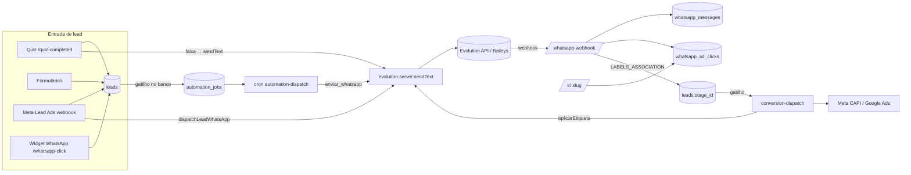

# WhatsApp Web + automações sobre a API Oficial — auditoria e projeto

> Data: 15/10/2026 · Escopo: página `/whatsapp`, automações, CRM, quiz, widget, conversão.
> Regra deste documento: **toda afirmação traz a fonte** — `código` (arquivo lido),
> `banco` (consulta somente-leitura em produção em 15/10), `ref` (repositórios
> indicados), `Meta` (documentação oficial/terceiros citados). O que não foi
> verificado está marcado **[VERIFICAR]** e não sustenta nenhuma decisão.

---

## 0. Resumo executivo

1. **Hoje o WhatsApp do sistema é só um disparador de mensagens automáticas
   sobre a Evolution API** (protocolo não-oficial, Baileys). Não há caixa de
   atendimento. A rota `/inbox` atende o **chat do site**, não o WhatsApp
   (`código`: `_app.inbox.tsx` usa `chat_conversations`).
2. **Em produção o uso é praticamente nulo**: 1 instância (desconectada),
   **1 mensagem** no total (recebida, sem lead), 0 opt-outs, 0 cliques de
   anúncio, 0 conversas de chat (`banco`). Não há base histórica a migrar —
   a troca de provedor é uma obra **nova**, não uma migração de dados.
3. **O acoplamento à Evolution é direto e espalhado**: 7 arquivos importam
   `evolution.server.ts` sem camada de abstração (§2.2), e o webhook
   (`whatsapp-webhook.ts`) interpreta o formato de payload dela. Trocar o provedor
   exige criar essa camada primeiro.
4. **Há dois achados de risco no que existe e que a API oficial não corrige
   sozinha**: o caminho de automação (`enviar_whatsapp`) **ignora opt-out e
   horário** (`código`, §2.4-A2), e o token da Meta fica em texto puro com
   `SELECT` liberado a membros da empresa (`código`, §2.4-A6).
5. **Recomendação**: construir um módulo `wa` próprio (conta/número, contato,
   conversa, mensagem, template, fila, webhook idempotente) sobre a **Cloud
   API oficial**, atrás de uma interface `WhatsAppProvider`; a Evolution vira
   provedor legado, desligado por empresa. A tela `/whatsapp` passa a ser o
   **atendimento** (estilo WhatsApp Web) e a configuração migra para
   `/settings/whatsapp`.
6. **Decisão de produto que vem antes do código**: usar **Coexistência**
   (número continua no app WhatsApp Business do cliente) ou **número dedicado
   à API** (§4.3). Recomendo coexistência como padrão.
7. **Dependências fora do código** (§9): verificação de empresa na Meta,
   permissões `whatsapp_business_management` / `whatsapp_business_messaging`
   (App Review), Embedded Signup, aprovação de templates. Isso tem prazo
   próprio e deve começar **em paralelo** à Fase 0.

---

## 1. O que são os dois repositórios indicados

| Repo | O que é de fato | Serve como |
|---|---|---|
| `bellopushon/whatsapp-cloud-api` (MIT) | Uma *skill* de agente: **documentação** da Cloud API (mensagens, webhooks, templates, janela de 24h, coexistência, mídia, erros) em markdown. Sem código executável. | **Fonte de especificação** para quem implementa. Instalável como skill do Claude Code (`npx skills add …`). |
| `sridecarpool/wacli` (MIT, Python) | **CLI** de um arquivo para operar a Cloud API (listar/criar/apagar templates com polling de aprovação, enviar, diagnosticar). Sem inbox, sem webhook, sem multi-tenant. O próprio README diz que para dashboard de atendimento é melhor um BSP. | **Referência do fluxo de templates** (criar → submeter → *poll* até APPROVED/REJECTED) e das regras de rejeição. **Não é base de código** do produto. |

Conclusão: nenhum dos dois é um "WhatsApp Web" nem um SDK para embutir. O
produto tem de ser construído; os repos entram como **especificação** e como
**ferramenta de operação** (ex.: instalar a skill no ambiente de desenvolvimento
e usar o `wacli` para testar a conta de homologação).

---

## 2. Auditoria do estado atual

### 2.1 Inventário

**Banco** (`código`: migrations; `banco`: colunas conferidas em produção)

| Tabela | Papel | Observação |
|---|---|---|
| `whatsapp_instances` | 1 conexão por empresa (QR da Evolution) | `UNIQUE(company_id)`; `instance_name` único |
| `whatsapp_automation_settings` | saudação + alerta ao corretor + janela + intervalo | caminho **legado** (§2.4-A10) |
| `whatsapp_messages` | log de saída/entrada | 12 colunas; sem conversa, sem status de entrega, sem mídia (§2.4-A3) |
| `whatsapp_optouts` | quem pediu para parar (por telefone) | só `whatsapp-automation.server.ts` e o webhook consultam |
| `whatsapp_ad_clicks` | atribuição CTWA + redirect `/ir/:slug` | `origem IN ('ctwa','redirect')`; código curto |
| `whatsapp_click_events` / `whatsapp_capi_dlq` | cliques do widget + reenvio CAPI | |
| `redirect_links` | links `/ir/:slug` do Google Ads | |
| `stage_conversion_mappings.whatsapp_label` | etiqueta ↔ etapa | **0 de 6** mapeamentos têm etiqueta (`banco`) |
| `automation_rules / _actions / _jobs` | motor de automação (gatilho no banco + worker) | 4 regras (3 ativas), 1 ação `enviar_whatsapp`, 131 jobs `done` |
| `chat_conversations / chat_messages / chat_operators / chat_departments / chat_quick_replies` | **chat do site** | 0 conversas; as duas primeiras estão na publicação `supabase_realtime` |
| `meta_lead_connections` (+ `_pages`, `_forms`, `_events`) | OAuth Meta do Lead Ads | `access_token text` (§2.4-A6) |

**Código** (`código`)

| Camada | Arquivos |
|---|---|
| Cliente Evolution | `lib/evolution.server.ts` (369 l.): `createInstance`, `getQrCode`, `getInstanceState`, `deleteInstance`, `sendText`, `reassinarEventos`, `listarEtiquetas`, `aplicarEtiquetaPorNome` |
| Server functions (UI) | `lib/whatsapp.functions.ts`: `getWhatsAppStatus`, `connectWhatsApp`, `refreshWhatsAppQr`, `disconnectWhatsApp`, `saveWhatsAppSettings`, `sendWhatsAppTest`; `lib/whatsapp-labels.functions.ts` |
| Disparo automático | `lib/whatsapp-automation.server.ts` (`dispatchLeadWhatsApp`); `routes/api/public/cron/automation-dispatch.ts` (ação `enviar_whatsapp`) |
| Entrada | `routes/api/public/whatsapp-webhook.ts` (`CONNECTION_UPDATE`, `MESSAGES_UPSERT`, `LABELS_ASSOCIATION`) |
| Atribuição | `lib/ctwa.server.ts`, `routes/ir.$slug.tsx`, `routes/api/public/whatsapp-click.ts` |
| Etiqueta → etapa | `lib/etiqueta-para-etapa.server.ts` |
| Conversão | `routes/api/public/cron/conversion-dispatch.ts`, `lib/meta-capi.server.ts`, `lib/whatsapp-capi.server.ts` |
| UI | `routes/_app.whatsapp.tsx` (668 l.: conexão por QR, mensagens automáticas, histórico), `settings/widgets` (botão), `LeadQuickActions` / `LeadDetailDialog` (`wa.me`) |
| Variáveis de ambiente | `EVOLUTION_API_URL`, `EVOLUTION_API_KEY`, `WHATSAPP_WEBHOOK_SECRET`, `WA_CAPI_RETRY_SECRET`, `META_APP_SECRET`, `META_VERIFY_TOKEN`, `CRON_SECRET` |
| Agendadores | `pg_cron`: `despacho-automacao` (1 min), `despacho-conversao` (5 min), `whatsapp_capi_retry_5min` (5 min) |

### 2.2 Mapa de ligações (o que toca o quê)



**Pontos de acoplamento direto à Evolution** — 7 arquivos importam
`evolution.server.ts` (verificado por `grep`; cada um terá de passar pela nova
interface): `whatsapp.functions.ts`, `whatsapp-automation.server.ts`,
`automation-dispatch.ts`, `conversion-dispatch.ts`, `etiqueta-para-etapa.server.ts`,
`whatsapp-labels.functions.ts` e **`quiz-completed.ts`** (`sendText` com
`instanceNameFor(company)`). Além disso, `whatsapp-webhook.ts` não importa a
Evolution mas **interpreta o formato do payload dela** (`MESSAGES_UPSERT`,
`LABELS_ASSOCIATION`, `externalAdReply`) e precisa de um irmão para o formato
oficial.

### 2.3 O que a medição em produção diz

| Medida (`banco`, 15/10/2026) | Valor | Leitura |
|---|---|---|
| Empresas / com instância WhatsApp | 2 / 1 | uma empresa usa |
| Instância | 1, `disconnected` | nada enviando hoje |
| `whatsapp_messages` | 1 linha (`inbound/reply`, 29/07, sem `lead_id`) | sem histórico relevante |
| `whatsapp_optouts` | 0 | |
| `whatsapp_ad_clicks` | 0 | CTWA/redirect nunca registraram aqui |
| `chat_conversations` | 0 | o "inbox" nunca foi usado |
| Mapeamentos com etiqueta | 0 de 6 | etiqueta↔etapa não está em uso |
| Regras de automação / jobs | 4 (3 ativas) / 131 `done` | o motor roda |
| Leads / telefone só com dígitos | 575 / 567 de 571 com telefone | mascara é exceção |

Implicação: **o risco de perda de dados na troca é desprezível**; o risco real é
de **escopo** (construir inbox, templates, fila, onboarding) e de **processo**
(aprovações Meta).

### 2.4 Achados

Severidade: 🔴 alta · 🟠 média · 🟡 baixa.

**A1 🔴 Provedor não-oficial e sem abstração.** A Evolution usa o protocolo não
oficial; a banimento é o risco central que o próprio código documenta
(`whatsapp-automation.server.ts`: "o risco de banimento é real"). O acoplamento
(§2.2) impede trocar sem tocar 7 arquivos e o parser do webhook.

**A2 🔴 `enviar_whatsapp` não respeita opt-out nem horário.** `código`:
`automation-dispatch.ts` não referencia `whatsapp_optouts` nem a janela
(`grep` vazio); só o caminho legado `dispatchLeadWhatsApp` respeita. Uma regra
de automação envia para quem pediu para parar — o gatilho clássico de denúncia
e de queda de qualidade do número. Na API oficial isso vira também **infração de
política**. Deve ser corrigido **antes** de qualquer troca (Fase 0).

**A3 🟠 Modelo de dados não comporta atendimento.** `whatsapp_messages` guarda
`to_phone` para os dois sentidos, não tem `conversation_id`, não registra
`sent→delivered→read`, não tem mídia, não tem autor (agente), e o índice único
`(lead_id, kind)` só serve a saudação única. Entrega a um inbox exige modelo novo
(§5).

**A4 🟠 Casamento telefone↔lead por "últimos 8 dígitos" (`ilike`).** Em
`whatsapp-webhook.ts` e `etiqueta-para-etapa.server.ts`. Funciona hoje porque 99%
dos telefones são só dígitos (`banco`), mas é aproximado: o mesmo final com DDD
diferente casa com a pessoa errada (a mesma classe de erro corrigida na
deduplicação). Com a API oficial o `wa_id` é canônico — o casamento passa a ser
exato (§5).

**A5 🟠 Idempotência e ordem de eventos ausentes.** O webhook insere em
`whatsapp_messages` sem chave de provedor única (`provider_message_id` não tem índice
ÚNICO em nenhuma migration — verificado por `grep`): reentrega da Evolution (que reenfileira em erro, como o código
comenta) duplica a mensagem. A API oficial reentrega com certeza
(`ref`: *WEBHOOKS.md — "Handle Duplicate Deliveries"*).

**A6 🔴 Token da Meta exposto a membros.** `código`: migration
`20260716151701`: `GRANT SELECT ON meta_lead_connections TO authenticated` +
policy por empresa, e `access_token text`. Qualquer membro lê o token pelo
cliente Supabase. O token do WhatsApp (de longa duração) **não pode** seguir
esse desenho: coluna sem `GRANT` ao `authenticated`, ou Vault.
**[VERIFICAR]** com uma consulta autenticada de teste (não executada aqui).

**A7 🟠 Etiqueta↔etapa depende de evento exclusivo da Evolution.** O caminho
inverso usa `LABELS_ASSOCIATION`. Nos documentos de coexistência lidos
(`ref` + terceiros) **não há** um evento equivalente confirmado para etiquetas
do app Business; fontes de terceiros divergem sobre "etiquetas" estarem ou não
suportadas — **[VERIFICAR]** na documentação oficial. Decisão de projeto: a
**etapa do CRM passa a ser a fonte da verdade**, sem depender de rótulo do
aparelho (§6.4).

**A8 🟠 Atribuição CTWA depende de `externalAdReply` do Baileys.** Funciona
(98,8% de `ctwaClid` medidos em 02/10 na instância da agência — `código`:
`ctwa.server.ts`), mas existe issue pública de `referral` perdido na emissão da
Evolution v2.3.7 (Meta/terceiros: GitHub `evolution-api#2645`). Na API oficial
o `referral` (com `ctwa_clid`) vem no próprio webhook `messages` (Meta; ausente
em anúncios de Status). O repositório de referência **não documenta** `referral`
— usar a documentação oficial.

**A9 🟡 Segredo do webhook na *query string* e comparação com `!==`.** Corrigido
parcialmente em 15/10 (tempo constante). A API oficial usa HMAC
`X-Hub-Signature-256` — o projeto já tem `verifyMetaSignature` (`meta-webhook`),
reutilizável.

**A10 🟠 Dois motores para a mesma coisa.** `dispatchLeadWhatsApp` (settings:
saudação/alerta) e `automation_rules` com ação `enviar_whatsapp`. Regras de
horário, opt-out e idempotência divergem entre eles (ver A2). Unificar no motor
de regras.

**A11 🟡 Envio síncrono com `setTimeout` de 8 s dentro do handler** (alerta ao
corretor). Prende a requisição; sem fila de saída por número nem *backoff*.

**A12 🟠 Realtime só cobre `chat_*`** (`banco`: publicação `supabase_realtime`).
Um inbox ao vivo precisa publicar as novas tabelas (ou usar *broadcast*).

**A13 🟡 Quiz → mensagem por faixa usa texto livre.** `quiz-completed.ts`
envia `sendText` sem checar a janela de 24h. Na API oficial, mensagem iniciada
pelo negócio **fora da janela só pode ser template** (`ref`: CONVERSATIONS.md,
erro 131047) — a feature de faixa passa a exigir **template aprovado**.

### 2.5 Reaproveitar × substituir

| Item | Destino |
|---|---|
| Motor de automação (regras/ações/jobs, gatilho no banco) | **Reaproveitar**; ações `enviar_whatsapp` → `enviar_template` / `enviar_texto` (janela) |
| Atribuição (`whatsapp_ad_clicks`, `/ir/:slug`, código curto) | **Reaproveitar**; trocar a fonte do clique (`referral`) |
| Conversão CAPI `business_messaging` + `ctwa_clid` | **Reaproveitar** (`meta-capi.server.ts` já suporta; exige `whatsapp_business_account_id` — agora disponível) |
| Opt-out por telefone | **Reaproveitar**, agora enforçado em **todo** envio na camada de provedor |
| OAuth Meta (`meta-graph.server.ts`, troca de código/token) | **Reaproveitar** como base do Embedded Signup |
| `chat_quick_replies`, `chat_operators`, `chat_departments` | **Reaproveitar** (respostas rápidas, filas, setores) |
| `whatsapp_instances`, QR, `connectWhatsApp`, `sendWhatsAppTest` | **Legado**: ficam atrás do provedor Evolution até o corte |
| `whatsapp_messages` | **Substituir** por `wa_messages` (§5); copiar a 1 linha existente |
| Etiqueta↔etapa via Evolution | **Substituir** (§6.4) |

---

## 3. Verificação na documentação (o que a Meta diz e o que é terceiro)

| Tema | Resultado | Fonte |
|---|---|---|
| Cobrança por mensagem desde 01/07/2025; serviço (resposta dentro da janela) gratuito; marketing/utilidade/autenticação pagos | confirmado | `ref` CONVERSATIONS.md; [pricing Meta](https://developers.facebook.com/documentation/business-messaging/whatsapp/pricing) |
| Cobrança em **BRL** para novas WABAs com *Sold-To* Brasil a partir de 01/07/2026; tabela em BRL publicada até 01/06/2026 | informado pela Meta; **valores não conferidos aqui** — [VERIFICAR] tabela | [pricing Meta](https://developers.facebook.com/documentation/business-messaging/whatsapp/pricing) |
| Janela de 24 h; fora dela só template; `131047` | confirmado | `ref` CONVERSATIONS.md, ERROR-CODES.md |
| `referral` com `ctwa_clid` no webhook `messages`; ausente em anúncios de Status | confirmado em documentação Meta espelhada | [Meta — text message webhook](https://developers.secure.facebook.com/documentation/business-messaging/whatsapp/webhooks/reference/messages/text) |
| Perda de `referral` na emissão da Evolution v2.3.7 | relato de usuário | [evolution-api#2645](https://github.com/evolution-foundation/evolution-api/issues/2645) |
| Coexistência: app ≥ v2.24.17, ≥ 7 dias de uso, abrir o app a cada ~13 dias, 20 msg/s, eco `smb_message_echoes`, sincronização `history`/`smb_app_state_sync` | `ref` COEXISTENCE.md (datado 26/06/2026) | repo de referência |
| Coexistência: sem selo/verificação oficial, grupos não sincronizam, dispositivos companheiros somem no onboarding | terceiros | [360dialog](https://docs.360dialog.com/partner/onboarding/whatsapp-coexistence) |
| Tiers de envio (1.000 / 10.000 / 100.000 / ilimitado por 24 h) e qualidade GREEN/YELLOW/RED | `ref` ERROR-CODES.md | repo de referência |
| Etiquetas do app em coexistência | **inconclusivo** (fontes divergem) | **[VERIFICAR]** |

---

## 4. Arquitetura-alvo

### 4.1 Camadas

```mermaid
flowchart TB
  UI[UI: /whatsapp (atendimento) · /settings/whatsapp] --> SF[Server functions]
  SF --> SVC[Serviço wa: conversas, envio, templates]
  AUTO[Motor de automação] --> SVC
  QUIZ[quiz-completed / widget] --> SVC
  SVC --> POL{Política de envio\nopt-out · janela 24h · horário · qualidade}
  POL --> OUT[(wa_outbox)]
  OUT --> PROV[[WhatsAppProvider]]
  PROV --> CLOUD[CloudApiProvider\nGraph API]
  PROV --> EVO[EvolutionProvider\nlegado, por empresa]
  CLOUD --> META[(Meta WhatsApp Cloud API)]
  META -- webhook HMAC --> WH[/api/public/wa-webhook/]
  WH --> EVT[(wa_webhook_events\nidempotente)]
  EVT --> PROC[Processador] --> DB[(wa_*)]
  PROC --> LEADS[(leads / funil / atribuição)]
  DB -- realtime --> UI
```

Princípios: (1) **toda saída** passa pela política (opt-out/janela/horário) — é
o conserto de A2 por construção; (2) **webhook só grava e responde 200**; o
processamento é idempotente e reprocessável; (3) **provedor intercambiável**
por empresa, para migrar sem *big bang*; (4) o **CRM continua dono** de lead,
etapa e conversão — o módulo `wa` não duplica esses conceitos.

### 4.2 Interface do provedor

```ts
interface WhatsAppProvider {
  sendText(i: { phoneId: string; to: string; body: string; replyTo?: string }): Promise<SendResult>;
  sendTemplate(i: { phoneId: string; to: string; name: string; lang: string; components: TemplateParams }): Promise<SendResult>;
  sendMedia(i: { phoneId: string; to: string; kind: 'image'|'video'|'audio'|'document'; mediaId?: string; link?: string; caption?: string }): Promise<SendResult>;
  markRead(i: { phoneId: string; messageId: string }): Promise<void>;
  getMedia(mediaId: string): Promise<{ url: string; mime: string }>;
  listTemplates(wabaId: string): Promise<Template[]>;
  createTemplate(wabaId: string, t: TemplateDraft): Promise<Template>;
  phoneHealth(phoneId: string): Promise<{ quality: 'GREEN'|'YELLOW'|'RED'; tier: string; isOnBizApp: boolean }>;
}
```

`SendResult` sempre devolve `{ ok, providerMessageId?, errorCode?, errorTitle?, fbtraceId? }`
(o `fbtrace_id` é exigido pela Meta para suporte — `ref` ERROR-CODES.md).

### 4.3 Decisão: Coexistência × número dedicado

| | Coexistência | Número dedicado à API |
|---|---|---|
| Atendente pode continuar no celular | **Sim** (app Business + API juntos) | Não — só pela nossa tela |
| Histórico de conversa | Sincroniza até 180 dias (se o cliente autorizar) | Começa vazio |
| Pré-requisito | Número já no **app Business** ≥ 7 dias | Número novo/livre |
| Vazão | 20 msg/s (limite menor) | até 80 msg/s |
| Selo oficial | Não | Possível |
| Risco operacional | Cliente precisa abrir o app a cada ~13 dias | Baixo |
| Etiquetas do app | **[VERIFICAR]** | n/a |

**Recomendação**: coexistência como **padrão** (menor atrito para equipes que já
atendem pelo celular e é o que o "WhatsApp Web" do produto vai espelhar), com
número dedicado para quem quer escala/automação pesada. Números hoje derrubados
pela Evolution podem estar restritos pelo WhatsApp — **[VERIFICAR]** caso a caso
antes de prometer migração.

### 4.4 Máquina de estados da janela de 24 h

```
sem_janela ──(cliente escreve)──▶ ABERTA (expira em last_inbound_at+24h)
ABERTA ──(24h sem resposta do cliente)──▶ sem_janela
sem_janela ──(template aprovado enviado)──▶ aguardando resposta (janela só abre se cliente responder)
```

Regras de UI/serviço: compositor **livre** só com janela aberta; fora dela o
compositor vira **seletor de template** com aviso e contagem regressiva;
`131047` é tratado como estado (não como erro a retentar).

---

## 5. Modelo de dados proposto (Postgres)

> Convenções do repositório: `company_id` em tudo, RLS por `check_membership`,
> `SECURITY DEFINER` com `search_path` fixo, `exception when others` em gatilhos.

```sql
-- Contas (WABA) e números
create table wa_accounts (
  id uuid primary key default gen_random_uuid(),
  company_id uuid not null references companies(id) on delete cascade,
  waba_id text not null,
  business_id text,
  display_name text,
  status text not null default 'active' check (status in ('active','pending','disabled')),
  created_at timestamptz not null default now(),
  unique (company_id, waba_id)
);

create table wa_phone_numbers (
  id uuid primary key default gen_random_uuid(),
  account_id uuid not null references wa_accounts(id) on delete cascade,
  company_id uuid not null references companies(id) on delete cascade,
  phone_number_id text not null unique,          -- id da Graph API
  display_phone text not null,
  mode text not null check (mode in ('coexistence','cloud_only','evolution')),
  provider text not null default 'cloud' check (provider in ('cloud','evolution')),
  quality text, messaging_tier text,
  is_on_biz_app boolean,
  coexistence_synced_at timestamptz,             -- fim do `history` sync
  last_health_at timestamptz,
  created_at timestamptz not null default now()
);

-- Segredos: tabela SEM grant para authenticated (só service_role)
create table wa_credentials (
  account_id uuid primary key references wa_accounts(id) on delete cascade,
  access_token_enc bytea not null,               -- pgsodium/Vault; nunca texto puro
  token_expires_at timestamptz,
  updated_at timestamptz not null default now()
);

-- Contato = identidade no WhatsApp (wa_id canônico), ligado a lead opcional
create table wa_contacts (
  id uuid primary key default gen_random_uuid(),
  company_id uuid not null references companies(id) on delete cascade,
  wa_id text not null,                           -- E.164 sem '+', como a Meta devolve
  profile_name text,
  lead_id uuid references leads(id) on delete set null,
  opted_out_at timestamptz,                      -- substitui whatsapp_optouts (copiar dados)
  created_at timestamptz not null default now(),
  unique (company_id, wa_id)
);

create table wa_conversations (
  id uuid primary key default gen_random_uuid(),
  company_id uuid not null references companies(id) on delete cascade,
  phone_number_id uuid not null references wa_phone_numbers(id),
  contact_id uuid not null references wa_contacts(id) on delete cascade,
  lead_id uuid references leads(id) on delete set null,
  status text not null default 'open' check (status in ('open','pending','resolved')),
  assigned_to uuid,                              -- user_id do atendente
  department_id uuid references chat_departments(id),
  last_inbound_at timestamptz,                   -- base da janela de 24h
  last_message_at timestamptz,
  last_message_preview text,
  unread_agent int not null default 0,
  origin jsonb,                                  -- {ctwa_clid, source_id, headline,…} do `referral`
  created_at timestamptz not null default now(),
  unique (phone_number_id, contact_id)
);
create index on wa_conversations (company_id, status, last_message_at desc);
create index on wa_conversations (company_id, assigned_to, status);

create table wa_messages (
  id uuid primary key default gen_random_uuid(),
  company_id uuid not null references companies(id) on delete cascade,
  conversation_id uuid not null references wa_conversations(id) on delete cascade,
  direction text not null check (direction in ('inbound','outbound')),
  origin text not null check (origin in ('customer','agent','automation','app_echo','history')),
  provider_message_id text,                      -- wamid
  type text not null,                            -- text|image|audio|video|document|template|interactive|reaction|…
  body text,
  payload jsonb,                                 -- conteúdo bruto do tipo
  template_name text,
  media_id uuid references wa_media(id),
  sent_by uuid,                                  -- agente (outbound/agent)
  status text not null default 'queued'
    check (status in ('queued','sent','delivered','read','failed','received')),
  error_code int, error_title text, fbtrace_id text,
  reply_to uuid references wa_messages(id),
  provider_ts timestamptz,                       -- ordem real (não created_at)
  created_at timestamptz not null default now()
);
create unique index wa_messages_provider_uniq on wa_messages (company_id, provider_message_id)
  where provider_message_id is not null;                       -- idempotência (corrige A5)
create index on wa_messages (conversation_id, provider_ts, id);

create table wa_message_status_events (            -- trilha sent→delivered→read→failed + preço
  id bigserial primary key,
  message_id uuid references wa_messages(id) on delete cascade,
  provider_message_id text not null,
  status text not null,
  occurred_at timestamptz not null,
  pricing jsonb,                                   -- {billable, category, pricing_model}
  error jsonb,
  unique (provider_message_id, status, occurred_at)
);

create table wa_media (
  id uuid primary key default gen_random_uuid(),
  company_id uuid not null references companies(id) on delete cascade,
  provider_media_id text, mime text, size_bytes int, sha256 text,
  storage_path text,                               -- bucket privado `wa-media`
  fetched_at timestamptz
);

create table wa_templates (
  id uuid primary key default gen_random_uuid(),
  account_id uuid not null references wa_accounts(id) on delete cascade,
  company_id uuid not null references companies(id) on delete cascade,
  name text not null, language text not null,
  category text not null check (category in ('MARKETING','UTILITY','AUTHENTICATION')),
  status text not null,                            -- PENDING|APPROVED|REJECTED|PAUSED|DISABLED
  components jsonb not null,
  rejection_reason text, quality text,
  synced_at timestamptz,
  unique (account_id, name, language)
);

-- Entrada bruta e idempotente de webhooks
create table wa_webhook_events (
  id uuid primary key default gen_random_uuid(),
  dedup_key text not null unique,                  -- hash(entry.id + field + messages[].id/statuses[].id+status)
  field text not null,                             -- messages|smb_message_echoes|history|smb_app_state_sync|message_template_status_update|…
  phone_number_id text,
  payload jsonb not null,
  status text not null default 'pending' check (status in ('pending','processed','failed')),
  attempts int not null default 0,
  last_error text,
  received_at timestamptz not null default now(),
  processed_at timestamptz
);
create index on wa_webhook_events (status, received_at);

-- Fila de saída (automação, retentativa, agendado)
create table wa_outbox (
  id uuid primary key default gen_random_uuid(),
  company_id uuid not null references companies(id) on delete cascade,
  phone_number_id uuid not null references wa_phone_numbers(id),
  to_wa_id text not null,
  kind text not null check (kind in ('text','template','media')),
  payload jsonb not null,
  idempotency_key text not null unique,            -- ex.: regra:lead:evento
  not_before timestamptz not null default now(),
  attempts int not null default 0,
  status text not null default 'pending' check (status in ('pending','sending','sent','failed','blocked')),
  blocked_reason text,                             -- opt_out | fora_da_janela | horario | qualidade | sem_template
  message_id uuid references wa_messages(id),
  created_at timestamptz not null default now()
);
```

**Realtime**: adicionar `wa_conversations` e `wa_messages` à publicação
`supabase_realtime` (hoje só `chat_*`), com RLS por empresa (e por atendente
quando a visibilidade for "só as minhas").

**Migração dos dados existentes**: 1 linha de `whatsapp_messages` e 0
`whatsapp_optouts` — script de cópia trivial; manter as tabelas antigas
somente-leitura até o corte do provedor Evolution.

**Normalização de telefone**: `wa_contacts.wa_id` é o canônico da Meta;
casamento com `leads.phone` por `normalizar_telefone_br` (a função da migração
de deduplicação, ainda **não aplicada** em produção — dependência da Fase 1) e
tratamento do 9º dígito do celular brasileiro (**[VERIFICAR]** como a Cloud
API devolve `wa_id` para números antigos).

---

## 6. Módulos e integrações

### 6.1 Entrada (webhook oficial)

`POST /api/public/wa-webhook` · `GET` (verificação `hub.challenge`).
1. Validar `X-Hub-Signature-256` com `META_APP_SECRET` (reuso de `verifyMetaSignature`).
2. Gravar em `wa_webhook_events` com `dedup_key`; **responder 200 imediatamente**.
3. Processador (mesmo processo + *sweeper* de `pending`/`failed`):
   - `messages` → upsert contato/conversa, `wa_messages` (idempotente), abrir
     janela (`last_inbound_at`), `referral` → `whatsapp_ad_clicks` (reuso do
     amarrador existente), opt-out por palavra-chave (reuso de `OPTOUT_PATTERN`).
   - `statuses` → `wa_message_status_events` + atualizar `wa_messages.status`
     (+ `pricing` para custo por conversa).
   - `smb_message_echoes` → mensagem `origin='app_echo'` (o cliente respondeu
     pelo celular).
   - `history` / `smb_app_state_sync` → importação única, **sem** disparar
     automação nem notificação.
   - `message_template_status_update` → atualizar `wa_templates.status`.
4. Falha de processamento **não** vira erro HTTP (Meta reentrega); fica `failed`
   com contador.

### 6.2 Saída

- **Atendente** (UI): *server function* `sendWaMessage` → política → provedor,
  síncrono, com `idempotency_key` gerado no cliente (evita duplo clique).
- **Automação / quiz / widget**: grava em `wa_outbox`; worker a cada minuto
  (mesmo padrão de `automation-dispatch`) com limite por número e *backoff*
  para `130429`/`131056`.
- **Política única** (`podeEnviar(contato, tipo)`): opt-out → horário →
  janela (texto livre só com janela; senão template) → qualidade do número
  (RED bloqueia marketing). Motivo do bloqueio gravado em `blocked_reason`.

### 6.3 Templates

CRUD + sincronização (`GET /{waba}/message_templates`) + estado
`PENDING→APPROVED/REJECTED` por webhook (o `wacli` faz *polling* de 60 s; aqui o
webhook substitui o polling). Editor valida as regras já levantadas pelo
`wacli`: **sem emoji em cabeçalho**, só URLs `https://`, contagem de variáveis
(`132000`). Categoria sugerida automaticamente (utilidade × marketing) com aviso
de custo.

### 6.4 Funil, etiquetas e conversão

- **Etapa é a fonte da verdade.** Mover card (UI/automação) continua disparando
  `conversion-dispatch`. O espelhamento em etiqueta do aparelho vira
  **opcional** e só se a verificação [VERIFICAR] confirmar suporte.
- **Quem etiqueta no aparelho move o card** — mantido apenas no provedor
  Evolution (legado) e removido da UI quando a empresa migra.
- **Atribuição**: `referral.ctwa_clid` → `whatsapp_ad_clicks` (já existe a
  tabela e o consumo em `conversion-dispatch`); CAPI `business_messaging` passa a
  usar `whatsapp_business_account_id` do `wa_accounts` (hoje exige `page_id`).
- **Redirect `/ir/:slug`**: sem mudança; o código curto continua sendo a ponte
  para o Google Ads.

### 6.5 Automações (motor existente)

| Ação atual | Nova |
|---|---|
| `enviar_whatsapp` (texto) | `enviar_template` (obrigatório fora da janela) e `enviar_texto` (só com janela aberta; senão a ação é `bloqueada`) |
| — | `atribuir_conversa` (atendente/setor), `resolver_conversa`, `enviar_para_fila_humana` |
| `dispatchLeadWhatsApp` (legado) | **migrar para regras** e aposentar `whatsapp_automation_settings` |

Novo gatilho: `whatsapp_message_received` (palavra-chave, primeira mensagem,
fora do expediente) — o motor hoje só tem `lead_created`, `stage_changed`,
`form_abandoned`.

### 6.6 Quiz e widget

- `quiz-completed`: o texto livre por faixa vira **escolha de template**
  por faixa (variáveis já mapeadas por `variaveisDaMensagem`); sem template
  aprovado, grava o lead/faixa e **não envia** (e avisa no painel).
- Widget `whatsapp-click`: segue como está; ganha opção de abrir a conversa no
  inbox quando o contato responder.

### 6.7 LGPD

Reuso de `direitos_do_titular` (migration `20261004240000`): exportar/excluir
passa a incluir `wa_contacts`, `wa_conversations`, `wa_messages`, `wa_media`.
Retenção configurável de mídia. Opt-out por palavra-chave **e** botão
"parar de receber" nos templates de marketing.

---

## 7. A nova página `/whatsapp` (atendimento)

**Layout** (3 colunas, desktop; 1 coluna navegável no mobile):

```
┌ Filtros ─────────┬ Lista de conversas ──┬ Conversa ───────────────────┬ Painel do lead ┐
│ Minhas / Fila /  │ busca · não lidas ·  │ cabeçalho (nome, número,    │ dados · etapa  │
│ Todas · Setor ·  │ janela (⏳ 3h12) ·   │ janela de 24h) · mensagens  │ origem/UTM ·   │
│ Aguardando · …   │ atribuído a          │ com ✓ ✓✓ · mídia · resposta │ notas · tags · │
│                  │                      │ citada · compositor         │ tarefas · IA   │
└──────────────────┴──────────────────────┴─────────────────────────────┴────────────────┘
```

Funcionalidades por prioridade:
- **P0**: lista + conversa em tempo real, envio de texto, estado de entrega
  (✓ enviada / ✓✓ entregue / ✓✓ azul lida), banner de janela com contagem,
  compositor→seletor de template fora da janela, atribuir/resolver, respostas
  rápidas (`/`, reuso de `chat_quick_replies`), painel do lead, opt-out visível.
- **P1**: mídia (imagem/áudio/documento/vídeo, envio e recebimento via
  `wa-media`), resposta citada, reações, notas internas (não enviadas),
  transferência com nota (reuso do popover), busca por conteúdo, notificação
  sonora/desktop (reuso da preferência do navegador).
- **P2**: listas/botões interativos, SLA e primeira resposta, métricas
  (volume, tempo de resposta, custo por categoria a partir de `pricing`),
  atribuição automática (round-robin, reuso de `pick_next_routing_member`).

**Configuração** sai da página e vai para `/settings/whatsapp`: conexão
(Embedded Signup), números, saúde (qualidade/tier), templates, regras,
opt-outs, horário de atendimento.

---

## 8. Segurança

| Tema | Decisão |
|---|---|
| Tokens | Tabela `wa_credentials` **sem** `GRANT` a `authenticated`; criptografia via Vault/pgsodium; rotação; nunca em `select *` do cliente. Corrigir também `meta_lead_connections` (A6). |
| Webhook | HMAC SHA-256 obrigatório; comparação em tempo constante; rejeitar sem assinatura; *replay* tolerado por idempotência. |
| Multi-tenant | Resolução da empresa **por `phone_number_id`** (nunca por campo do corpo); RLS por empresa em todas as `wa_*`. |
| Mídia | Bucket privado, URLs assinadas curtas, *proxy* de download (a URL da Meta expira — `ref` MEDIA.md), limite de tamanho por tipo. |
| Abuso | Limite de taxa por empresa/número; teto diário por categoria; bloqueio de marketing quando qualidade RED. |
| Auditoria | Quem enviou o quê (`sent_by`), `fbtrace_id` em falhas, trilha de status. |
| Entrada pública | As rotas `quiz-completed` e `whatsapp-click` já foram endurecidas em 15/10 (destino = telefone do lead; 1 mensagem/24h). |

---

## 9. Plano de entrega

> Estimativas em **dias de engenharia** (1 pessoa sênior), sem contar as
> esperas da Meta. São estimativas, não medições.

### Fase 0 — Preparação e correções (3–4 d) · **começa já**
- Conserto A2: opt-out + horário no caminho `enviar_whatsapp` (e teste que
  impeça regressão).
- Camada `WhatsAppProvider` + `EvolutionProvider` (envolvendo o que existe) e
  migração dos 7 pontos de chamada para a interface — **sem mudar
  comportamento**.
- Corrigir A6 (`GRANT`/token).
- **Em paralelo (não-código)**: verificação do negócio na Meta; confirmar o app
  Meta (o do Lead Ads pode ser reaproveitado se tiver os produtos WhatsApp);
  pedir `whatsapp_business_management` + `whatsapp_business_messaging`;
  criar `config_id` do Embedded Signup; escolher número de homologação.
- **Aceite**: nenhum import de `evolution.server` fora do provedor; suíte
  verde; teste mostrando opt-out respeitado pela automação.

### Fase 1 — Fundação oficial (5–7 d)
- Migrations `wa_*` + RLS + realtime; `wa_credentials`.
- `CloudApiProvider` (texto, template, mídia, *mark read*, health).
- `wa-webhook` (GET/POST, HMAC, `wa_webhook_events`, processador, *sweeper*).
- Aplicar a migração de deduplicação (`normalizar_telefone_br`) — pré-requisito.
- **Aceite**: número de homologação envia e recebe; reentrega do mesmo
  webhook não duplica; status `sent→delivered→read` visível no banco.

### Fase 2 — Onboarding e templates (4–6 d)
- Embedded Signup (coexistência e número dedicado), salvando WABA/número/
  token; sincronização `history` e contatos; tela de saúde do número.
- Templates: sincronizar, criar, enviar para aprovação, estado por webhook.
- **Aceite**: cliente conecta o número sem tocar em QR; template criado na
  tela aparece `APPROVED` sem ação manual.

### Fase 3 — Atendimento (WhatsApp Web) P0 (7–10 d)
- Rota `/whatsapp` (3 colunas), conversa em tempo real, janela de 24h,
  compositor/template, atribuição, respostas rápidas, painel do lead.
- **Aceite**: atendente responde um lead do início ao fim sem sair da tela;
  fora da janela só consegue enviar template; nenhum envio a contato com
  opt-out.

### Fase 4 — Automação e integrações (5–7 d)
- Ações `enviar_template` / `enviar_texto` / `atribuir_conversa`; gatilho
  `whatsapp_message_received`; fila `wa_outbox` com limite e *backoff*.
- Faixa do quiz → template; atribuição por `referral` → CAPI
  `business_messaging` com `whatsapp_business_account_id`.
- Aposentar `dispatchLeadWhatsApp`.
- **Aceite**: regra "lead criado → template" envia uma vez, respeita opt-out
  e horário; conversão de venda de lead vindo de anúncio sai com `ctwa_clid`.

### Fase 5 — Mídia, P1/P2 e corte (5–8 d)
- Mídia ponta a ponta; notas; busca; métricas e custo por categoria.
- Migração por empresa: ligar provedor `cloud`, observar 7 dias, desligar
  Evolution; remover QR e `whatsapp_instances` da UI.
- **Aceite**: 0 chamadas à Evolution por 7 dias; custo/categoria visível.

**Total**: ~29–42 dias de engenharia + o tempo de aprovação da Meta
(o caminho crítico real).

---

## 10. Riscos

| Risco | Prob. | Impacto | Mitigação |
|---|---|---|---|
| Aprovação/verificação da Meta demora | Alta | Bloqueia Fases 2+ | Iniciar já; homologar com número de teste |
| Número hoje derrubado não é reaproveitável | Média | Cliente perde o canal | Verificar caso a caso; plano de número novo |
| Templates reprovados (marketing × utilidade) | Média | Automação sem envio | Validador de regras (§6.3) e fila "sem template" visível |
| Qualidade do número cai (opt-out/bloqueio) | Média | Tier reduzido, templates pausados | Política de envio, opt-out em todo canal, painel de saúde |
| Coexistência com limite de 20 msg/s | Baixa | Atraso em disparo em massa | Fila com limite por número |
| Cliente não abre o app a cada ~13 dias | Média | Coexistência cai | Alerta no painel de saúde (`is_on_biz_app`) |
| Custo por mensagem (BRL) maior que o previsto | Média | Margem | Mostrar custo por categoria; tabela BRL **[VERIFICAR]** |
| Etiqueta do aparelho não disponível | Média | Perde espelhamento | Etapa como fonte da verdade (§6.4) |

---

## 11. Decisões tomadas (15/10/2026)

| # | Pergunta | Decisão | Consequência no projeto |
|---|---|---|---|
| 1 | Coexistência × número dedicado | **Coexistência** | Embedded Signup com `featureType: whatsapp_business_app_onboarding`; ingestão de `smb_message_echoes`, `history` e `smb_app_state_sync`; alerta de "abrir o app a cada ~13 dias"; limite de 20 msg/s por número |
| 2 | Números atuais | **WhatsApp Business (app)** | Elegíveis à coexistência (exige ≥ 7 dias de uso e app ≥ v2.24.17 — conferir por cliente) |
| 3 | App Meta | **Reaproveitar** o do Lead Ads | Adicionar os produtos WhatsApp ao app existente; `META_APP_SECRET` já é o do webhook; pedir `whatsapp_business_management` e `whatsapp_business_messaging` |
| 4 | Cobrança | **Cliente, WABA própria** | Cada empresa tem WABA e meio de pagamento na Meta; sem revenda; custo por categoria exibido na tela só como informação |
| 5 | Atendimento | **Multiusuário** | Filas, atribuição e visibilidade "só as minhas" já no P0 (Fase 3) — reaproveita `chat_operators`/`chat_departments` |
| 6 | Evolution | **Corte seco por cliente** | Sem contingência: a empresa liga a Cloud API e a instância Evolution é removida. Exige checklist de corte (§9, Fase 5) e janela combinada com o cliente |

## 12. Fase 0 — o que foi entregue

Branch de trabalho: `main`. Sem mudança de comportamento para o usuário, exceto os
dois consertos de segurança.

| Entrega | Onde | Verificação |
|---|---|---|
| Interface `WhatsAppProvider` + `EvolutionProvider` | `src/lib/whatsapp/` | 7 arquivos migrados; teste de isolamento garante que só `evolution-provider.ts` importa a Evolution |
| Política de envio única (opt-out → horário) | `src/lib/whatsapp/politica.ts` | 21 testes, incluindo erro de consulta que **bloqueia** |
| **A2** — `enviar_whatsapp` respeita opt-out e horário | `automation-dispatch.ts` | teste de ordem (política antes do envio) + mutação |
| Opt-out com variações do 9º dígito | `variantesDoNumero` | fixo de 8 dígitos (2–5) não vira celular — falha encontrada pelo teste |
| `quiz-completed` pelo canal da empresa + opt-out | `quiz-completed.ts` | horário **não** se aplica: a pessoa acabou de concluir o quiz |
| **A6** — token da Meta fora do alcance do navegador | migration `20261015170000_token_meta_somente_servidor.sql` | **escrita, NÃO aplicada** |

**Decisão de comportamento** — alerta a número fixo (`cfg.para`) não passa por
opt-out de lead, como já era no caminho legado; só mensagens ao lead passam.

**Pendente do usuário** — aplicar a migration do token (`REVOKE`/`GRANT`) e, em
paralelo, iniciar as aprovações na Meta (§9, Fase 0, "não-código").

---

## 12b. Fase 1 — o que foi entregue

| Entrega | Onde | Verificação |
|---|---|---|
| Tabelas `wa_*`, RLS, realtime | `supabase/migrations/20261015180000_wa_fundacao.sql` | **11 testes SQL num Postgres 16 real** (descartável); mutação (status rebaixando) derruba T7 |
| Ingestão atômica e idempotente | funções `wa_registrar_mensagem`, `wa_registrar_saida`, `wa_aplicar_status` | reentrega não duplica nem soma "não lidas"; status fora de ordem nunca regride; eco do app não abre a janela; `referral` do 1º contato não é sobrescrito |
| Parser de payload | `src/lib/whatsapp/cloud/payload.ts` | texto, mídia, botão/lista, reação, status (com preço e erro), eco, histórico, campo desconhecido, lixo |
| Assinatura HMAC | `cloud/assinatura.ts` | tempo constante; sem segredo nunca confere |
| Cifra do token | `cloud/cifra.ts` (AES-256-GCM, `WA_TOKEN_KEY`) | falha fechado; adulteração e chave errada falham |
| `CloudApiProvider` | `cloud/cloud-provider.ts` | token decifrado só em memória; erro Meta → classe + `fbtrace_id`, sem token em log |
| Processador | `cloud/processador.ts` | reentrega sem efeito colateral; número desconhecido = `ignored`; erro real = `failed` com contador |
| Envio na conversa | `cloud/envio.ts` | opt-out → janela → provedor → registro; janela fechada **não chama a Meta** |
| Webhook | `routes/api/public/wa-webhook.ts` | assinatura antes do `JSON.parse`; 200 mesmo com falha de processamento |
| Varredor | `routes/api/public/cron/wa-webhook-sweep.ts` | **falha fechado** (sem `CRON_SECRET`, recusa) |
| Escolha de provedor | `canal.ts` | número oficial tem prioridade; sem a migração aplicada, cai na Evolution (comportamento de antes) |

### Achado novo (medido em 15/10/2026): segredo padrão nas rotas de cron

`automation-dispatch`, `conversion-dispatch`, `meta-retry` e `meta-reprocess-failed`
usam `process.env.CRON_SECRET || 'altflow_retry_sync_secret'`, e os `cron.job`
do `pg_cron` enviam esse mesmo texto. **`CRON_SECRET` não está definido** no
serviço (`Environment` só tem `NODE_ENV`/`PORT`; o `.env` não tem a chave —
verificado por nome, sem ler valor). Resultado: qualquer pessoa que leia o
repositório pode disparar esses quatro endpoints. Impacto: disparo antecipado de
filas (despacho de conversão, automações, reprocesso Meta), não leitura de dados.
Correção exige **coordenar** `CRON_SECRET` no `.env` com a troca do cabeçalho nos
`cron.job` — por isso não foi alterada aqui. Rotas novas já nascem fail-closed.

### Variáveis de ambiente novas (servidor)

| Variável | Para quê |
|---|---|
| `WA_TOKEN_KEY` | 32 bytes em base64 (`openssl rand -base64 32`); cifra do token do WhatsApp |
| `WA_WEBHOOK_VERIFY_TOKEN` | segredo da verificação `hub.verify_token` |
| `CRON_SECRET` | já era lida; **passa a ser obrigatória** para o varredor |
| `META_APP_SECRET` | já existe; a assinatura do webhook do WhatsApp usa o mesmo app |

Callback no app da Meta (produto WhatsApp): `https://<domínio>/api/public/wa-webhook`,
campos `messages`, `smb_message_echoes`, `history`, `smb_app_state_sync`.

### Ainda NÃO existe (Fase 2)

Onboarding (Embedded Signup) que **cria** `wa_accounts`/`wa_phone_numbers`/
`wa_credentials`; templates; tela. Hoje a conta é inserida à mão para homologar.

---

## 12c. Fase 2 — o que foi entregue

| Entrega | Onde | Verificação |
|---|---|---|
| Estado do número e templates (banco) | `20261015190000_wa_templates_e_estado.sql` | **8 testes SQL num Postgres 16 real**: status de template nunca rebaixa, `PARTNER_REMOVED` desconecta pelo telefone, progresso do histórico só avança |
| Eventos novos | `cloud/payload.ts`, `cloud/processador.ts` | `message_template_status_update`, `account_update`, progresso do `history` |
| Cliente da Graph API | `cloud/graph.ts` | troca de código, inscrição na WABA, leitura do número (com *fallback* de campos), templates paginados com teto, `smb_app_data` |
| Validador de templates | `cloud/templates.ts` | 20 casos: nome, idioma, variáveis em sequência, exemplos obrigatórios, emoji no cabeçalho, URL só `https://`, limites |
| Onboarding | `cloud/onboarding.ts` | número de **outra empresa** recusado; token **cifrado** em repouso; nada gravado se a inscrição falhar |
| Server functions | `src/lib/whatsapp-cloud.functions.ts` | empresa só da sessão; sem coluna de token no retorno; exige `WA_TOKEN_KEY` antes de falar com a Meta |
| Tela | `/settings/whatsapp` | conexão (coexistência ou só API), saúde do número, templates com validação em tempo real |

Quatro mutações nas regras de segurança do onboarding foram todas detectadas
(posse do número, token em claro, validação de template, gravação sem inscrição).

### O que **não** foi exercitado contra a Meta

Não há credencial de homologação neste ambiente. Foram escritos a partir da
documentação de referência e estão marcados **[VERIFICAR]** no código:

1. `redirect_uri` na troca do código do Embedded Signup.
2. Nomes dos campos de `GET /{phone_number_id}` (`messaging_limit_tier`,
   `is_on_biz_app`…): a função tenta o conjunto completo e cai para o mínimo.
3. Limites de tamanho de template (corpo 1024, cabeçalho 60…): são **avisos ao
   autor**, e o servidor da Meta continua sendo a palavra final.
4. Versão do SDK (`v25.0`) e `featureType` de coexistência.
5. A tela **não foi aberta num navegador** (exige sessão e banco): só build,
   tipos e testes de lógica.

### Variável nova

| Variável | Para quê |
|---|---|
| `WA_ES_CONFIG_ID` | `config_id` da configuração de Embedded Signup criada no app da Meta |

### Pendências conhecidas da Fase 2

- **Desconectar** o número pela tela (revogar e inscrever) — hoje só por SQL.
- Templates de **mídia** no cabeçalho (exigem upload prévio) e de **autenticação**.
- Renovação/expiração do token (o de Embedded Signup é de longa duração; a
  expiração aparece no erro `190` → classe `autenticacao`).

---

## 12d. Fase 3 — atendimento (WhatsApp Web)

`/whatsapp` passa a ser o **atendimento** quando a empresa tem número oficial
conectado; sem ele, segue a tela da Evolution (QR) até o corte. Configuração e
templates ficam em `/settings/whatsapp`.

| Entrega | Onde | Verificação |
|---|---|---|
| Lista de conversas (Minhas / Fila / Todas / Resolvidas), busca, não lidas, "aguardando resposta" | `modules/atendimento/` | filtros puros: 26 testes; renderização da lista conferida |
| Conversa em tempo real, marcas ✓ ✓✓ (azul = lida), agrupamento por dia (fuso SP), ordem pela hora do **provedor** | `Conversa.tsx`, `lib/mensagens.ts` | testes de agrupamento e de ordem |
| Banner da janela de 24h com contagem regressiva | `cloud/janela.ts` | borda exata de 24h testada |
| Compositor: texto livre (janela aberta) · seletor de template (janela fechada) · bloqueado (opt-out) · resolvida | `lib/compositor.ts` | opt-out vence janela aberta (mutação detectada) |
| Envio de **template** na conversa | `cloud/envio.ts` | exige APPROVED; variável faltando/fora do corpo é recusada **antes** de falar com a Meta |
| Atribuir / resolver / reabrir | `whatsapp-atendimento.functions.ts` | conversa conferida contra a empresa da **sessão**; destino precisa ser membro (mutação detectada) |
| Respostas rápidas (`/`) | reaproveita `chat_quick_replies` | — |
| Painel do lead + origem de anúncio | `PainelDoLead.tsx` | — |
| Tempo real | `useAtendimento.ts` | `wa_conversations` e `wa_messages` na publicação (migração da fundação) |

### Decisões de comportamento

- Quem **responde** uma conversa sem responsável **assume** a conversa.
- "Lida" só é marcada com a aba **visível**.
- O texto digitado **não é descartado** quando o envio é recusado.
- Rascunho **não atravessa** conversas.
- Opt-out bloqueia texto **e** template.

### O que ainda não existe

- **Mídia** (envio e recebimento de imagem/áudio/documento): hoje a conversa
  mostra `[Imagem]`/`[Áudio]` sem o arquivo. É a Fase 5.
- **Notas internas**, **busca dentro da conversa**, **reações**, resposta citada.
- **Visibilidade por papel** ("só as minhas"): todo membro vê todas as
  conversas da empresa; o filtro "Minhas" é de conveniência, não de segurança.
- Template com variável em **cabeçalho ou botão** no atendimento.
- A tela **não foi aberta num navegador** (exige sessão, banco e uma conta Meta
  real): só build, tipos, renderização estática e testes de lógica.

---

## 12e. Fase 4 — automação sobre o canal oficial

| Entrega | Onde | Verificação |
|---|---|---|
| Evento **"Mensagem recebida no WhatsApp"** (só do cliente; eco, saída e histórico não disparam) | `20261015200000_wa_automacao.sql` | **8 testes SQL** num Postgres 16 com as definições REAIS do motor; mutação (tirar o `WHEN` do gatilho) detectada |
| Ações **Enviar template** e **Atribuir conversa** | `src/lib/automacao/acoesDeWhatsApp.ts` | 29 testes; 3 mutações detectadas |
| Conversa garantida para lead que nunca escreveu | função `wa_obter_ou_criar_conversa` | idempotente, não abre a janela de 24h |
| **Retentativa sem repetir o que deu certo** | `executarAcoes.ts` | mutação detectada (ver abaixo) |
| Faixa do quiz → **template aprovado** | `faixaDoQuiz.ts` + campo na tela de faixas | texto só vai com janela aberta; senão devolve o que configurar |
| Conversão `business_messaging` com `whatsapp_business_account_id` | `meta-capi.server.ts` | `aplicarMensageria` pura e testada |
| Envio legado aposentado para quem está na API oficial | `whatsapp-automation.server.ts` | pula e **registra o motivo** |

### Defeito encontrado e corrigido no motor (vale para qualquer ação)

Na retentativa, o job **reexecutava todas as ações**, inclusive as que já tinham
dado certo. Numa regra "enviar mensagem → mover etapa", uma falha em "mover
etapa" fazia a mensagem sair **de novo, até 4 vezes**. Agora o resultado de cada
ação é identificado pelo id e o que terminou em `ok` ou `pulada` não repete.

### Decisões de comportamento

- **Texto livre** só vai com a janela de 24h aberta; fora dela a ação é
  *pulada* com o motivo ("use Enviar template"). Não é tentado: cada recusa da
  Meta (131047) pesa na qualidade do número.
- Erro **não retentável** (número fora do WhatsApp, template reprovado) vira
  *pulada*; só o que a Meta marca como temporário (limite de taxa, 5xx) volta à fila.
- Política de opt-out e horário vale para mensagem a **lead**; alerta a número
  fixo da empresa não passa por ela (como já era).
- Quiz: horário **não** se aplica (a pessoa acabou de concluir e espera).

### Desvio do plano original

O plano previa uma tabela `wa_outbox`. **Não foi criada**: `automation_jobs` já é
a fila (tentativas, teto, cron por minuto, deduplicação) e uma segunda fila
duplicaria estado. Limite de taxa e *backoff* vêm do lote de 25/min e do retorno
a `pending` em erro temporário. Reavaliar se houver disparo em massa.

### Limites desta fase

- A tela de regras e o campo de template na faixa **não foram abertos num
  navegador**: build, tipos e testes de lógica.
- Template com variável em cabeçalho/botão continua recusado.
- Disparo em massa (campanha) **não existe**: a fila atende gatilhos por evento.
- `whatsapp_automation_settings` (saudação/alerta legados) ainda existe e é
  usado pelas empresas na Evolution; some no corte (Fase 5).

---

## 12f. Fase 5 — mídia, uso, notas e corte

| Entrega | Onde | Verificação |
|---|---|---|
| Mídia **recebida**: registra, baixa cedo, guarda em bucket **privado**, confere o `sha256` | `cloud/armazenamento.ts` | download, hash divergente, 404 → `expired`, teto de tamanho, falha do bucket |
| Mídia **enviada** (imagem, vídeo, áudio, documento) com legenda | `envio.ts`, `midia.ts` | mesma política do texto (opt-out → janela); áudio sem legenda; documento com nome |
| Limites de envio (5/16/16 MB; documento 20 MB) e formatos | `classificarArquivoParaEnvio` | formato fora da lista **não vira documento calado**: a tela pergunta |
| **Posse** do arquivo e da mídia | `caminhoEhDaEmpresa`, `urlDaMidia` | caminho com `..`/outra empresa recusado; mídia de outra empresa = inexistente |
| Notas internas (nunca vão ao cliente) | tabela `wa_notes` | tabela à parte, não flag em mensagem |
| Uso por categoria (contagem de cobráveis) | `wa_uso_por_categoria` | conta **uma vez por mensagem**; janela de datas |
| Corte da Evolution com pré-requisitos medidos | `corte.ts` + tela | 6 bloqueantes, 2 avisos; frase de confirmação; reavalia no servidor |
| **Papéis**: `viewer` não atende | `empresaParaAtender` | mutação detectada |

SQL: **8 testes** (T40–T47 + T41b) num Postgres 16 real; mutações detectadas
(contar cada status; trocar a mídia de uma mensagem).

### Lacuna das fases anteriores, corrigida aqui

As ações de atendimento (enviar, atribuir, resolver) conferiam só "é da empresa".
Medido em produção: os papéis existentes são `owner`, `admin`, `member`, `viewer`
— então um **visualizador conseguia enviar mensagem** em nome da empresa. Agora
`viewer` só lê; o corte exige `owner`/`admin`.

### Decisões

- Mídia recebida é baixada **na hora** (melhor esforço) e de novo ao abrir se
  falhou: o id da Meta expira, e servir de lá faz a imagem sumir.
- O uso é **contagem**, não reais: a tabela de preços em BRL não é dado do banco.
- O corte **desliga o legado antes** de remover a sessão; se a remoção falhar,
  nada fica enviando pela Evolution por engano.

### O que NÃO foi feito (e por quê)

- **Remover QR / `whatsapp_instances` da tela legada**: depende de **todas** as
  empresas terem migrado. Hoje a tela legada ainda atende quem não tem número
  oficial.
- **Valor em reais** do custo: exigiria a tabela BRL vigente da Meta — **[VERIFICAR]**.
- **Disparo em massa** (campanha) — fila por evento apenas.
- **Reações, resposta citada, busca dentro da conversa**.
- A tela **não foi aberta num navegador** (nenhuma das fases): sessão, banco com
  as migrações e uma conta Meta real são pré-requisito.

---

## 13. Perguntas originais (respondidas em §11)

1. **Coexistência ou número dedicado** como padrão? (§4.3)
2. Os clientes já têm **WhatsApp Business (app)** nos números atuais, ou usam o
   WhatsApp pessoal? Isso decide a elegibilidade para coexistência.
3. O **app Meta** do Lead Ads será reaproveitado ou criamos um novo para o
   WhatsApp? (Define o `config_id` e a revisão.)
4. Quem é o **provedor de cobrança** das mensagens: o cliente (WABA própria,
   cartão na Meta) ou a agência (revenda)? Muda onboarding e BRL/Billing Hub.
5. Atendimento **multiusuário** desde o P0 (atribuição/filas) ou começa com
   caixa única?
6. Manter **Evolution como contingência** por empresa durante a transição, ou
   corte seco por cliente?

## 13. Revisão de segurança independente (15/10/2026)

Três revisões independentes, somente leitura, sobre o módulo `wa` e as rotas
que ele toca; cada achado foi conferido no código e, onde cabia, na base de
produção (só leitura) antes de virar correção.

### Corrigido

| Achado | Correção |
| --- | --- |
| Excluir/consultar instância Evolution por nome vindo do cliente | Nome recalculado a partir da empresa e conferido (`evolution-nome.ts`); falha no corte restaura as flags |
| Funções de nuvem (signup, templates) sem checar papel | `empresaParaAdministrar` / `empresaParaAtender` (`papeis.ts`); papel desconhecido = o menor |
| Regras e ações de automação graváveis por qualquer membro; ação com `company_id` de outra empresa | RLS: só owner/admin escrevem; `WITH CHECK` amarra a ação à empresa da regra (migração `220000`) |
| Fila de jobs sem reserva atômica; execução repetida | `reservar_jobs_de_automacao` (RPC) + liberação de presos; resultado por ação persistido |
| Cron com segredo padrão no repositório | `CRON_SECRET` (comparação em tempo constante); `CRON_ESTRITO=1` recusa o legado; `scripts/rotacionar-cron` |
| SSRF no webhook de automação | `validarDestinoDeWebhook` (https, sem IP privado/interno, DNS resolvido), `redirect: manual`, cabeçalhos em lista de permissão |
| Amplificação de envio por automação | Teto por conversa/24h e por empresa/h (`tetoDeEnvio.ts`); gatilho do banco limita 5 jobs/conversa/10 min e 500 pendentes |
| Opt-out por palavra solta dentro de frase | Só a mensagem inteira (`sair`, `parar`, `stop`...) |
| Vazamento de motivo detalhado e sobrescrita de `nome`/`faixa` na rota pública do quiz | Motivo genérico; variáveis do navegador entram antes de `nome`/`faixa` |
| Webhook Meta: corpo ilimitado | 413 acima de 2 MB, antes e depois da leitura |
| Reprocessamento sem espera | `next_attempt_at` com 2, 4, 8… até 60 min |
| Download de mídia com token para qualquer URL | Só https em domínio da Meta, sem redirecionamento, leitura com teto |
| Envio de mídia: arquivo inexistente / nome livre | HEAD no link assinado; nome saneado antes de sair e de gravar |
| `customData` do pixel público aceitava qualquer chave | Lista de permissão com tipo e tamanho (`customDataPublico.ts`) |
| Etiqueta repetida derrubava a ação; espera configurável sem teto | `ignoreDuplicates`; teto de 300 s |
| `waba_id` já conectado a outra empresa dava erro cru | Mensagem clara (índice `wa_accounts_waba_uniq`) |

### Residual (não resolvido por código)

- **DNS rebinding** na chamada do webhook de automação: a validação resolve o
  nome antes, mas o `fetch` resolve de novo. Fecha com proxy de saída.
- **Sem limite de taxa** em rotas públicas (`quiz_capture_lead`, `pixel-event`,
  `whatsapp-click`): precisa de nginx/Cloudflare.
- **Telefone de terceiro** no quiz: mitigado pelos tetos, não eliminado; exigiria
  OTP/CAPTCHA.
- **Visibilidade**: todo membro vê todas as conversas da empresa. Visibilidade
  por papel ainda é decisão em aberto.
- **Tokens do CAPI** seguem na query string da chamada à Meta (formato da API).

### Mudança de comportamento

Membros (`member`) deixam de editar regras de automação pela interface; só
`owner` e `admin`.

## 14. Atendimento no padrão de inbox (16/10/2026)

Referência observada: o inbox de um produto concorrente (só layout e fluxo —
nada de código ou identidade visual copiado). Reconstruído na nossa base, sem
migração.

| Fatia | Entrega | Onde |
| --- | --- | --- |
| 1 | `/whatsapp` sem número vira "Conecte seu WhatsApp"; Evolution só para quem ainda a usa (`evolutionConectada`, lida do banco — não consulta a Evolution) | `ConectarPrimeiro.tsx`, `obterEstadoDoWhatsAppOficial` |
| 2 | Barra de visões (Entrada, Minhas, Não atribuídas, Resolvidas), selo do canal e avatar do responsável na lista | `VisoesDoInbox.tsx`, `ListaDeConversas.tsx` |
| 3 | Painel do contato recolhível: Contato, Negociação (etapa, temperatura, pontuação, origem), Etiquetas, anúncio, Notas — lidos do lead sob RLS | `PainelDoLead.tsx`, `useLeadDoPainel` |
| 4 | Menu "…": não lida, pendente, pesquisar na conversa, copiar número, abrir no CRM, ver informações (sheet fora do `xl`) | `MenuDaConversa.tsx` |

**Como se interliga (regras que o menu respeita)**
- *Marcar como não lida* passa por função de servidor (`empresaParaAtender` +
  `conferirConversa`) e só sobe o contador quando ele está em 0. A conversa
  fecha em seguida: a leitura automática (aba visível) a zeraria na hora.
- *Pendente* é o status `pending` que o banco já tem; entra em "Entrada" e
  mostra o selo no cabeçalho. Conversa resolvida não oferece pendente.
- *Pesquisar* usa a mesma consulta de mensagens da conversa (cache
  compartilhado) — alcança as últimas 500 mensagens carregadas.
- Nada do menu contorna política de envio (opt-out, janela, teto).

**Fora desta rodada (exige migração):** seguir conversa, menções, agendar
mensagem, exportar CSV, tarefas por lead, bloquear contato (hoje o opt-out é
do cliente; "bloquear" pela equipe precisa de regra própria na camada de
política).

**Achado de qualidade:** o `vitest` incluía só `*.test.ts`; os testes de
renderização (`.test.tsx`) nunca rodavam. Corrigido em `vitest.config.ts`.

### 14.1 Fatia 5: seguir conversa e menções (16/10/2026)

Migração `20261016120000_wa_seguir_e_mencoes.sql` (**aplicar antes do deploy
do código**; sem ela as visões ficam vazias e "Seguir" devolve erro).

| Peça | Regra |
| --- | --- |
| `wa_conversation_followers` | uma linha por (conversa, pessoa); RLS: cada pessoa só lê as próprias; escrita só servidor |
| `wa_mentions` | uma por (nota, mencionado); `read_at` nulo = não lida; RLS: só o mencionado lê |
| Seguir automático | ao **receber a conversa** (atribuição) e ao **ser mencionado** |
| Menção | só membro da mesma empresa, nunca a si mesmo, até 10 por nota |
| Leitura | abrir a conversa marca as menções dela como lidas |
| Visões | "Seguindo" (não resolvidas) e "Menções" (não lidas, mesmo resolvida) |

Ensaio de banco: 4 testes novos (visibilidade pessoal, autor não vê menção
alheia, navegador não escreve, duplicata). Mutação na política foi pega.

### 14.2 Fatia 6: agendar mensagem (16/10/2026)

Migração `20261016140000_wa_mensagens_agendadas.sql` (**aplicar antes do
deploy**; sem ela o despacho não faz nada e agendar devolve erro).

| Peça | Regra |
| --- | --- |
| `wa_scheduled_messages` | pendente → enviando → enviada / falhou / cancelada; RLS: equipe da empresa lê; escrita só servidor |
| Reserva | `reservar_mensagens_agendadas` (atômica, `SKIP LOCKED`); `liberar_..._presas` devolve à fila quem caiu no meio |
| Envio | o mesmo `enviarTextoNaConversa` do atendente: **opt-out e janela de 24h valem na hora do envio** — agendar não contorna a política |
| Falha | recusa de política é definitiva (marca "não enviada" com o motivo); só falha temporária do provedor volta, 5 min depois, até 3 tentativas |
| Limites | de 1 min a 30 dias à frente; 10 pendentes por conversa |
| Execução | dentro do `automation-dispatch` (cron de 1 min que já existe) — nenhum job novo no `pg_cron`, nenhum segredo novo |

Aviso na tela: se o horário escolhido cai depois do fim da janela, o diálogo
diz que a mensagem livre não sairá (só template).

### 14.3 Editor de template com pré-visualização (16/10/2026)

Referência: a tela de templates da Central WhatsApp API do concorrente
(editor em blocos + prévia de conversa ao vivo). Sem migração.

| Peça | Detalhe |
| --- | --- |
| Pré-visualização | bolha de conversa com cabeçalho, corpo (exemplos no lugar de `{{n}}`), rodapé e botões |
| Formatação | `*negrito*`, `_itálico_`, `~tachado~`, ` ```mono``` ` — marcador só vale colado ao texto e sem atravessar linha, como no aplicativo |
| Barra de ferramentas | envolve a seleção; "Variável" insere o próximo `{{n}}` na posição do cursor |
| Contadores | cabeçalho e rodapé x/60; corpo x/1024 (já existia) |
| Validação | a mesma do servidor (`validarTemplate`), em tempo real |

**Fica para depois:** salvar rascunho separado de "enviar à Meta" (exige onde
guardar rascunho: coluna/status em `wa_templates`), mídia de cabeçalho e
amostra de mídia, Flows e Carrossel.

### 14.4 Rascunho de template (16/10/2026)

Migração `20261016160000_wa_template_rascunhos.sql` (**aplicar antes do
deploy**; sem ela a lista de rascunhos fica vazia e "Salvar rascunho" devolve
erro).

| Peça | Regra |
| --- | --- |
| `wa_template_drafts` | definição em `jsonb` (objeto); fora de `wa_templates`, que espelha a Meta e é reescrita pela sincronização |
| Escrita | só servidor, papel de administrador; equipe lê (RLS) |
| Salvar | aceita texto incompleto — validar é no envio; teto de 50 por empresa |
| Enviar à Meta | com rascunho aberto, o id vai junto e o rascunho **só some se a criação deu certo** |
| Tela | lista "Rascunhos" no cartão de templates (Continuar / Apagar) e botão "Salvar rascunho" no editor |

Ensaio de banco: 2 testes novos (definição precisa ser objeto; visibilidade).

### 14.5 Número "apenas receptivo" (16/10/2026)

Migração `20261016180000_wa_numero_apenas_receptivo.sql` — **aplicar ANTES do
deploy**: a lista de conversas passa a ler `wa_phone_numbers.receive_only`, e
sem a coluna a consulta falha.

Significado, conforme a própria dica da tela de referência ("o canal não pode
enviar mensagem ativa nem ser usado em campanhas"):

| Origem / tipo | Número apenas receptivo |
| --- | --- |
| Resposta livre do atendente **dentro** da janela de 24h | permitida |
| Template (mensagem ativa) — atendente ou automação | **recusada** (`canal_apenas_receptivo`) |
| Automação/campanha: texto, template, mídia | **recusada**; a ação vira "pulada" com o motivo |
| Fora da janela | o compositor mostra o aviso em vez do seletor de template |

Regras: coluna nasce **desligada** (nada muda para números existentes);
alterar exige administrador e só atinge número da própria empresa; a recusa é
decidida no mesmo ponto das demais políticas de envio, depois do opt-out.
Interpretação de "automação = campanha" é nossa: os gatilhos do sistema
(lead criado, mudança de etapa) são envios ativos, não respostas.

### 14.6 Conexão manual e número de teste da Meta (16/10/2026)

Para testar o atendimento sem depender do Embedded Signup. Sem migração.

- **Número de teste reivindicado** no app FYNDATRACK_BETA (WhatsApp → Etapa 1):
  `+1 (555) 665-9150`, Phone Number ID `1357165290819369`, WABA
  `1712518090288635`. O token temporário é gerado no painel da Meta por quem
  administra — nunca passa por este repositório nem pelo chat.
- **Código:** `concluirOnboarding` foi dividido; do token em diante é
  `concluirComToken` (número lido com o token, posse, inscrição com callback
  próprio, gravação cifrada). O Embedded Signup e a conexão manual usam a mesma
  função, então a regra de posse vale nos dois.
- **Tela:** "Avançado: conexão manual (número de teste)" em Configurações →
  WhatsApp oficial; token em campo de senha, limpo da memória ao conectar.
- **Limites do número de teste:** pela documentação da Meta (não verificado
  hoje), só envia para destinatários previamente verificados e o token expira;
  não exercita o Embedded Signup em si.

### 14.7 Exportar conversa em CSV (16/10/2026)

Menu "…" → "Exportar conversa (CSV)". Sem migração.

- **Conteúdo:** mensagens da conversa (data/hora ISO, direção, origem, autor,
  tipo, texto, status, template). **Notas internas não entram.** O nome do
  autor só aparece nas mensagens do atendente (automação e cliente não levam
  nome de pessoa). Teto de 5 000 mensagens, com aviso quando corta.
- **Segurança:** função de servidor com papel e empresa conferidos; filtra as
  mensagens pela empresa. No arquivo, toda célula de texto livre que começa com
  `=`, `+`, `-`, `@` ou tab é neutralizada (`'`): planilha executa fórmula, e o
  texto é do cliente.
- **Formato:** separador `;` e BOM, para o Excel em português abrir com acento.


## 15. Ensaio local sem número da Meta (16/10/2026)

Objetivo: chegar à liberação da API com o máximo já validado. Tudo em
`scripts/ensaio-local/`, sempre em `127.0.0.1`, nunca contra produção.

| Camada | O que prova | Como rodar |
| --- | --- | --- |
| **Base local fiel** | O esquema e as **permissões** (ACLs) da produção, copiados só como estrutura (sem dados) com `pg_dump -s`. Replay das migrações **não** serve: 12 das 148 falham do zero (o repositório não reproduz a produção; ex.: `leads.source`, `meta_ad_attribution`). | `bootstrap-supabase.sql` + restaurar o dump do esquema |
| **Ensaio SQL** | 66 testes (`ensaio-wa-fundacao/testes.sql`) passam na base local: fundação, fase 2/4/5, endurecimento (viewer/admin), fila, gatilho, retenção, seguir/menções, agendadas, rascunhos, receptivo. | `psql -d leadflow_ensaio` dentro de BEGIN/ROLLBACK |
| **Meta falsa** | O código REAL de HTTP (`graph.ts`, `cloud-provider.ts`) fala por socket com um servidor que imita a Graph API: leitura do número, templates, troca de código, inscrição da WABA com callback próprio, envio e os erros 131047/131030/131050/130429/5xx/190. 16 testes, com prova de mutação. | `npx vitest run src/lib/whatsapp/cloud/metaFalsa.test.ts` |

**Limite que não some:** a Meta falsa foi escrita a partir da documentação.
Ela prova que o código fala o protocolo que entendemos, **não** que a Meta se
comporta assim. Embedded Signup, coexistência, nomes reais de campo, aprovação
de template e entrega continuam [VERIFICAR] até o número de teste.

**Achados do ensaio:** (1) as migrações do repositório não reproduzem a produção;
(2) `META_GRAPH_BASE_URL` só vale para localhost (host externo é ignorado), para
um engano nunca mandar o token da Meta a outro servidor.


### 15.1 Ensaio de ponta a ponta e a tela aberta pela primeira vez (16/10/2026)

Ambiente (`scripts/ensaio-local/subir.sh`): Postgres 16 + **PostgREST real** + gateway que imita
`/rest/v1`, `/auth/v1` (login falso) e `/storage/v1` + Meta falsa. O app roda com `npm run dev:ensaio`.
`e2e-wa.mjs` envia webhooks **assinados** à rota real e confere o banco: **31 cenários passam, 0 falham,
2 lacunas conhecidas**. Prova de mutação: quebrar a verificação de assinatura e o opt-out foi detectado.

**Passou na tela `/whatsapp` (primeira vez aberta num navegador, com sessão e banco):**
lista de 11 conversas vinda do webhook; envio de texto (corpo e token corretos na Graph API, mensagem
gravada, conversa atribuída a quem respondeu); status enviado/entregue/lido; **envio bloqueado a quem pediu
para parar, sem chamada à Meta**; fora da janela de 24 h só template aprovado (o reprovado não aparece);
template enviado com nome/idioma corretos; criação de template (exige exemplo de cada variável; payload no
formato da documentação); "Sincronizar" não apaga o que a Meta não devolveu; nota interna com menção
(não vai à Meta); Seguir; Exportar CSV (3 mensagens, nota fora, autor só do atendente); agendamento
despachado pelo cron e **agendada para quem pediu para parar falha com motivo, sem envio**; visualizador
é barrado no servidor ("acesso somente leitura"); celular sem rolagem horizontal.

**Achados (nenhum corrigido nesta rodada):**
1. **Resposta citada não é gravada**: o parser extrai `replyToWamid`, o processador não preenche
   `wa_messages.reply_to` (já era backlog; o `payload` guarda o dado).
2. **Violação/restrição da conta não alerta**: `account_update` só trata PARTNER_REMOVED,
   ACCOUNT_OFFBOARDED e ACCOUNT_RECONNECTED; o resto é ignorado em silêncio (nomes reais [VERIFICAR]).
3. **Visualizador vê composer, Resolver e responsável habilitados**; só o servidor barra. A interface
   deveria desabilitar ou ocultar.
4. **Contato que pediu para parar não tem aviso na conversa**; o bloqueio só aparece ao tentar enviar.
5. **Cabeçalho no celular (375 px)**: o botão "Número e templates" cobre o selo "N não lidas".
6. **Seletor de responsável lista o visualizador** como atribuível.
7. **Aviso de erro** ("O contato pediu para não receber mensagens.") ficou na tela por mais de um minuto.
8. **Login ainda diz "Lovable CRM"** (sobra de marca).
9. **Erro de hidratação** no `AppLayout` (`Trace: {traceId}` aleatório no estado de carregamento): anterior
   ao módulo, inofensivo.

**Não coberto (limites do ambiente):** realtime (o WebSocket não é simulado: a tela só atualiza ao recarregar),
Embedded Signup, coexistência real, aprovação real de template, entrega real, e tudo o que for `[VERIFICAR]`.


### 15.2 Correções dos achados (17/10/2026)

| # | Achado | Correção | Onde |
| --- | --- | --- | --- |
| 1 | Resposta citada não era gravada | O processador liga `wa_messages.reply_to` à mensagem original (mesma empresa); a bolha mostra a citação ("Cliente / Equipe" + trecho) e clicar leva à original. Original fora do banco: nada é gravado e nada falha. | `processador.ts`, `Conversa.tsx`, `mensagens.ts` |
| 2 | Violação/restrição da conta sem alerta | Cartão **"Avisos da Meta"** na configuração (só dono/admin): lista os eventos de conta e as notificações que o sistema não trata, com o nome como a Meta enviou e gravidade por pista do nome. Isolado por empresa. Sem migração. | `avisos.ts`, `listarAvisosDaMetaWhatsApp`, `_app.settings.whatsapp.tsx` |
| 3 | Visualizador via controles habilitados | Composer vira aviso "acesso somente leitura"; sem Resolver; responsável, menu (itens que escrevem) e notas desabilitados. O servidor continua sendo quem barra. | `compositor.ts`, `Conversa.tsx`, `Atendimento.tsx`, `MenuDaConversa.tsx`, `PainelDoLead.tsx` |
| 4 | Opt-out sem aviso na conversa | Causa real: o servidor checa o contato **e** a lista legada `whatsapp_optouts`; a tela só lia o contato. Agora o bloqueio por lista legada marca o contato e a tela recarrega e troca o composer pelo aviso. | `envio.ts` (3 pontos), `Conversa.tsx` |
| 5 | Cabeçalho sobreposto a 375 px | Título quebra em linhas, selo não encolhe, botão vira só o ícone no celular. Medido: sem sobreposição e sem rolagem horizontal. | `Atendimento.tsx` |
| 6 | Visualizador na lista de responsáveis | Fora da lista **e** recusado no servidor ao atribuir. | `listarAtendentesWhatsApp`, `atribuirConversaWhatsApp` |
| 7 | Aviso de erro "preso" | **Não é defeito**: o Sonner pausa o timer com a aba em segundo plano (painel do teste). Nada alterado. | - |
| 8 | Login com "Lovable CRM" | Marca do Leadflow no login. | `AuthLayout.tsx`, `Logo.tsx` |
| 9 | Erro de hidratação | `suppressHydrationWarning` nos dois "Trace:" aleatórios do `AppLayout`. Sem erro na navegação conferida. | `AppLayout.tsx` |

Verificação: 1 555 testes e 33 cenários de ponta a ponta passam; mutação nos dois comportamentos novos do
servidor (citação e alinhamento do opt-out) foi detectada. A tela foi conferida no navegador como visualizador e
como dono. Os nomes reais dos eventos de conta da Meta seguem **[VERIFICAR]**.


### 15.3 Espaço da tela de atendimento: modo foco (17/10/2026)

**Problema medido** (largura da área de conversa, px): em 1366 px, 378; em 1536 px, 392 (menu aberto) ou 440;
em 1920 px, 440. Duas causas: a grade tinha três colunas fixas (200 + 340 + 300 = 840 px) e a página tinha teto de
80rem (1280 px). Em 1280/1366 px com o menu aberto a grade passava da área útil e **cortava o painel do contato**.
Recolher só o menu ganhava 52 px, e nada acima de 1536 px.

**Decisão:** modo foco **no mesmo domínio**, e não um subdomínio (sessão e cookie são por origem; exigiria DNS,
certificado, nginx, permissão de origem no Supabase e quebraria os atalhos para o CRM, sem ganhar espaço que o modo
foco não ganhe).

| Mudança | Detalhe |
| --- | --- |
| Menu | Recolhe sozinho ao entrar no atendimento e **volta ao estado anterior ao sair** (verificado). Ícones agora distintos: Chat ao vivo = fone de atendimento; WhatsApp = glifo próprio (antes os dois eram o mesmo balão). |
| Largura | A página sai do teto de 1280 px (`data-largura-total`) e sangra até a borda do conteúdo. |
| Colunas | Visões saem da coluna lateral e viram **abas numa linha só** acima da lista. Painel do contato **sob demanda** (botão no cabeçalho; aberto de partida só a partir de 1600 px; escolha guardada). Grade `320px + minmax(0,1fr) (+300px)`: a conversa encolhe em vez de empurrar o painel para fora. |
| Tela cheia | Botão que esconde menu e barra superior (e usa a tela cheia do navegador; Esc sai). Em memória: recarregar ou sair do atendimento volta ao normal. |
| Lista | Linha compacta (~64 px; cabem cerca de o dobro). **Tempo de espera** no lugar da data (cinza < 15 min, âmbar < 1 h, vermelho a partir de 1 h) e ordenação "Maior espera" (quem espera há mais tempo primeiro). Responsável só pelas iniciais; some o "sem responsável" repetido. |
| Acabamento | Cabeçalho duplo vira uma barra só na coluna da lista; placeholder do composer encurtado. |

**Resultado medido** (conversa, px; menu recolhido): 1280 → **912** (painel fechado) / 612 (aberto);
1366 → **998**; 1536 → **868** (painel aberto); 1920 → **1252** (painel aberto). Nada cortado em nenhum tamanho;
celular (375 px) sem rolagem horizontal. 1 566 testes e 33 cenários de ponta a ponta passam.


### 15.4 Seletor de template na conversa (17/10/2026)

**Diagnóstico (CRO + UX):** o compositor fora da janela usava um `<select>` nativo: o painel de opções é do sistema
operacional (translúcido, sem controle de estilo), a barra ocupava a largura inteira da conversa e a escolha não
mostrava **nada** da mensagem. Mandar o template errado custa dinheiro (categoria cobrada) e qualidade do número.

**Mudança** (`EnviarTemplate.tsx`, `templatesAprovados.ts`):
- Cartão compacto, centrado (máx. 42rem), em vez de uma barra de ponta a ponta.
- Seletor próprio: lista **opaca** (fundo branco, opacidade 1, sem desfoque), pesquisável quando há mais de 5, cada
  item com nome, categoria em português (Utilidade/Marketing), idioma e resumo do texto.
- **Prévia como o cliente vai ver** (cabeçalho, corpo, rodapé, botões), atualizada ao digitar; `{{n}}` fica à vista
  enquanto falta valor.
- Campo de cada variável com a **dica vinda do exemplo dado à Meta** ("ex.: sábado às 10h").
- Linha de estado ("Falta preencher {{2}}" / "Pronto para enviar. Ctrl+Enter também envia."); botão fixo no rodapé do cartão.
- Compositor com teto de 60% da altura: no celular ele ocupava quase a tela toda.

**Defeito de conteúdo corrigido:** a primeira variável era sugerida com o nome do contato, mas, sem nome, vinha o
**telefone** ("Oi +55 (27) 91111-0111!"). Agora só sugere nome de verdade (lead ou perfil do WhatsApp).

**Verificado** (navegador, banco local, Meta falsa): envio de template com 2 variáveis chega com o corpo no formato
da Meta e fica gravado com o texto já preenchido; celular (375 px) em uma coluna, sem rolagem lateral, botão sempre visível.


## 16. Central WhatsApp API do concorrente: levantamento (22/10/2026)

Referência observada (só leitura, na conta do próprio usuário): `/settings/whatsapp-api` do Kinbox. Só layout e fluxo —
nada de código, textos ou identidade visual copiado. A conta observada é uma conta de demonstração: **Flows e Carrossel
estavam vazios e sem botão de criar**, então os construtores deles **não foram vistos**; só o hub, as listas e o editor de
templates (que tinha 3 templates aprovados).

### 16.1 O que existe lá

| Peça | Observado |
| --- | --- |
| Hub "Central WhatsApp API" | Página com 3 cartões: **Templates** ("criação, gerenciamento e publicação"), **Flows** ("criação, validação, preview e publicação") e **Carrossel** ("templates com múltiplos cards, mídia e botões"). Cada um abre uma lista própria (`/templates`, `/flows`, `/carousel`). |
| Lista de templates | Busca por nome; filtro por **status com contagem** ("Tudo 3", "Submetido", "Aprovado 3"); colunas Nome (com total), Canal, Categoria, Idioma, Status, Última edição; menu "…" com **Sincronizar Meta**. |
| Lista de Flows / Carrossel | Busca por nome e estado vazio ("Parece que você ainda não adicionou nenhum registro…"). Sem botão de criar visível nesta conta. |
| Editor de template | **Página inteira** (não modal), com 3 seções recolhíveis cada uma com ✓ de estado: *Informações básicas* (canal, nome com contador x/512, idioma, categoria), *Conteúdo* e *Estrutura de botões*. Prévia **em formato de celular** (cabeçalho do contato, bolha, campo de mensagem) sempre à direita. Ações: **Salvar** e **Enviar atualização para a Meta**. |
| Conteúdo | *Tipo de variável* (Número), *Amostra de mídia* no cabeçalho (Nenhum…), cabeçalho x/60 com "Adicionar variável", corpo x/1024 com barra: **assistente de IA** (faísca), **emoji**, B, I, tachado, código e "Adicionar variável"; bloco *Amostras de variáveis* por parte (Corpo…); rodapé x/60 ("Ex: Não responder"). |
| Botões | "Adicionar botão" oferece **Personalizado** (resposta rápida), **Acessar o site** e **Copiar código da oferta** (cupom). |

### 16.2 Onde o Alt Leadflow já está igual ou melhor

Prévia ao vivo; formatação do WhatsApp; exemplos de variável; contadores; validação com o mesmo critério do servidor; rascunho
separado de enviar (eles têm "Salvar" e "Enviar atualização"); cadastro em passos sem rolagem, modelos prontos, aviso de Utilidade
com cara de promoção, "Antes de enviar"; seleção de conta (WABA) quando há mais de uma.

### 16.3 Lacunas (o que eles têm e nós não)

| # | Lacuna | Tamanho | Observação |
| --- | --- | --- | --- |
| 1 | **Hub "Central WhatsApp API"** com cartões e listas por recurso | pequeno | só navegação; a tela de templates de hoje mora em Configurações → WhatsApp oficial |
| 2 | **Filtro por status com contagem** + busca por nome na lista de templates | pequeno | dados já existem em `wa_templates` |
| 3 | **Editar template existente** e "Enviar atualização para a Meta" | médio | a Meta limita edições (frequência e o que muda); exige guardar a versão e tratar a recusa |
| 4 | **Botão "Copiar código da oferta"** (`COPY_CODE`) | pequeno | novo tipo em `validarTemplate` e `montarComponentes` |
| 5 | **Amostra de mídia no cabeçalho** (imagem, vídeo, documento) | médio | upload de amostra à Meta (sessão de upload) e armazenamento |
| 6 | **Tipo de variável** (número × nome) | pequeno/médio | a Meta aceita parâmetros nomeados; muda montagem, envio e prévia |
| 7 | **Emoji** e **assistente de IA** na barra do corpo | pequeno / médio | IA depende de provedor e custo; emoji é só um seletor |
| 8 | **Carrossel** (template com vários cards: mídia, texto e botões) | grande | construtor próprio + regras da Meta (nº de cards, mesma estrutura entre cards) |
| 9 | **Flows** (criação, validação, prévia, publicação) | muito grande | API de Flows da Meta e editor do JSON do Flow; envio e recebimento das respostas no atendimento |

**Não vimos** (e portanto não dá para copiar o comportamento): construtor de Flows, construtor de Carrossel, o que o assistente de IA
faz, e as regras de erro deles. Para esses dois, a fonte passa a ser a documentação da Meta, não a tela do concorrente.


## 17. Digisac (Conexões) e Kinbox (Frases rápidas): levantamento (22/10/2026)

Referência observada (só leitura, em contas do próprio usuário): `/services` do Digisac e `/settings/quick-phrases` do Kinbox. Só layout e
fluxo — nada de código, texto ou identidade visual copiado. Nada foi criado, salvo ou alterado nos dois sistemas.

### 17.1 Digisac: a conexão é uma entidade com tipo e provedor

| Peça | Observado |
| --- | --- |
| Lista | Cartões com nome, **tipo** ("WhatsApp" ou "WhatsApp Business API - Gupshup": o **provedor aparece no cartão**), número, bot, setor padrão e estado (Conectado / Desconectado). Abas **Ativas / Arquivadas** com contagem, busca por nome e **Filtros** (Tipo, Status, Robô, Departamento). |
| Alerta no cartão | Triângulo amarelo na conexão oficial: "Sua conexão está com restrições de uso… Acesse a aba Saúde da Conta para entender o motivo". |
| Menu do cartão | Visualizar, Histórico de eventos, Editar, Arquivar, **Reiniciar**, **Desconectar**, Excluir (separado e em vermelho). |
| Adicionar conexão | **Catálogo de canais com cota do plano**: WhatsApp, WhatsApp Business API, Webchat, E-mail, Telegram, SMS, Instagram, Messenger, Reclame Aqui; cada cartão diz "Limite atingido" / "1 disponível" / "Contrate essa conexão". Um cartão lateral explica o passo seguinte. |
| Detalhe | Cabeçalho (nome, estado, tipo+provedor, telefone com copiar), **faixa de atenção** com ações ("Ver manual", "Detalhes da saúde") e 4 abas: **Sobre**, **Saúde da conta**, **Histórico de eventos**, **Configurar acessos**. |
| Sobre | Dados principais (nome, tipo "WhatsApp Oficial", **provedor**, telefone, nome do app, ID da conexão), bloco **Atendimento** (robô conectado, **departamento padrão**), cartão "Conta conectada", criado/atualizado em. |
| Saúde da conta | Três cartões: **Status** (Ativa), **Saúde** (qualidade: "Saúde alta") e **Envio de mensagens** ("Alcance limitado: atende aos requisitos, mas possui algumas limitações"); cartão educativo sobre saúde da conta. |
| Histórico de eventos | Tabela Início / Fim / Status (Online, Offline) / Motivo (Conectado, Desligado), ordenável e filtrável: períodos de instabilidade da conexão. |
| Configurar acessos | Quem pode usar a conexão: usuário, cargo, departamentos, status (Habilitado), busca, filtro e seleção em lote. |

**Não visto:** o assistente de "Adicionar" do WhatsApp Business API (a cota estava no limite) e, portanto, **quais provedores existem** além do
Gupshup; o texto completo do aviso de "Novidades" (vinha truncado: fala da nova cobrança por mensagem da Meta e de redirecionar conversas).

### 17.2 Como o Leadflow modela hoje (e por que "provedor" pesa)

- `provider.ts`: `ProvedorId = "evolution" | "cloud"`. A empresa tem **um canal ativo** (`resolverCanal`): a Cloud API tem prioridade e a
  Evolution deixa de ser consultada (corte seco por cliente, 15/10/2026). `whatsapp_instances` é único por empresa.
- `wa_accounts` (WABA) e `wa_phone_numbers` (vários por empresa) já existem; **não há** "provedor" por número (é sempre a Meta direto), nem
  departamento padrão, nem lista de quem acessa, nem arquivar, nem histórico de estado.
- Na tela, o número oficial e a conexão por QR code vivem em lugares e modelos diferentes; o selo de saúde só mostra o `status` do número.

### 17.3 Saúde da conta: dá para ter igual, com dado da própria Meta

Documentação oficial (lida em 22/10/2026): o campo `health_status` existe nos nós **WABA, número de telefone e template** e devolve
`can_send_message` = `AVAILABLE` / `LIMITED` (com `additional_info`) / `BLOCKED` (com `errors[].error_description` e `possible_solution`),
mais `entities[]` dizendo qual nó causa o limite (número, template, WABA, business ou app). Exemplo: `GET /{id}?fields=health_status`.
É a fonte natural do "Alcance limitado" do Digisac.

### 17.4 Kinbox: Frases rápidas

Lista com busca por atalho ou frase, filtro "Tudo", filtro por **Categorias**, seletor de colunas e "Nova frase". Colunas: Atalho (contagem),
Respostas, Categorias, **Visível para**. Formulário: **Tipo** (Texto…), Atalho, Visível para (Todos os membros…), **Categorias criáveis ao
digitar**, Texto com **emoji** e **variáveis**, **Anexar documentos**. O Leadflow tem atalho + texto (+ setor opcional): faltam categorias,
visibilidade por pessoa, variáveis, emoji, anexo e filtros.
