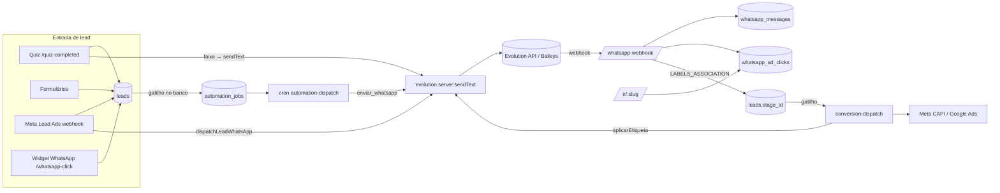

# WhatsApp Web + automações sobre a API Oficial — auditoria e projeto

> Data: 15/10/2026 · Escopo: página `/whatsapp`, automações, CRM, quiz, widget, conversão.
> Regra deste documento: **toda afirmação traz a fonte** — `código` (arquivo lido),
> `banco` (consulta somente-leitura em produção em 15/10), `ref` (repositórios
> indicados), `Meta` (documentação oficial/terceiros citados). O que não foi
> verificado está marcado **[VERIFICAR]** e não sustenta nenhuma decisão.

---

## 0. Resumo executivo

1. **Hoje o WhatsApp do sistema é só um disparador de mensagens automáticas
   sobre a Evolution API** (protocolo não-oficial, Baileys). Não há caixa de
   atendimento. A rota `/inbox` atende o **chat do site**, não o WhatsApp
   (`código`: `_app.inbox.tsx` usa `chat_conversations`).
2. **Em produção o uso é praticamente nulo**: 1 instância (desconectada),
   **1 mensagem** no total (recebida, sem lead), 0 opt-outs, 0 cliques de
   anúncio, 0 conversas de chat (`banco`). Não há base histórica a migrar —
   a troca de provedor é uma obra **nova**, não uma migração de dados.
3. **O acoplamento à Evolution é direto e espalhado**: 7 arquivos importam
   `evolution.server.ts` sem camada de abstração (§2.2), e o webhook
   (`whatsapp-webhook.ts`) interpreta o formato de payload dela. Trocar o provedor
   exige criar essa camada primeiro.
4. **Há dois achados de risco no que existe e que a API oficial não corrige
   sozinha**: o caminho de automação (`enviar_whatsapp`) **ignora opt-out e
   horário** (`código`, §2.4-A2), e o token da Meta fica em texto puro com
   `SELECT` liberado a membros da empresa (`código`, §2.4-A6).
5. **Recomendação**: construir um módulo `wa` próprio (conta/número, contato,
   conversa, mensagem, template, fila, webhook idempotente) sobre a **Cloud
   API oficial**, atrás de uma interface `WhatsAppProvider`; a Evolution vira
   provedor legado, desligado por empresa. A tela `/whatsapp` passa a ser o
   **atendimento** (estilo WhatsApp Web) e a configuração migra para
   `/settings/whatsapp`.
6. **Decisão de produto que vem antes do código**: usar **Coexistência**
   (número continua no app WhatsApp Business do cliente) ou **número dedicado
   à API** (§4.3). Recomendo coexistência como padrão.
7. **Dependências fora do código** (§9): verificação de empresa na Meta,
   permissões `whatsapp_business_management` / `whatsapp_business_messaging`
   (App Review), Embedded Signup, aprovação de templates. Isso tem prazo
   próprio e deve começar **em paralelo** à Fase 0.

---

## 1. O que são os dois repositórios indicados

| Repo | O que é de fato | Serve como |
|---|---|---|
| `bellopushon/whatsapp-cloud-api` (MIT) | Uma *skill* de agente: **documentação** da Cloud API (mensagens, webhooks, templates, janela de 24h, coexistência, mídia, erros) em markdown. Sem código executável. | **Fonte de especificação** para quem implementa. Instalável como skill do Claude Code (`npx skills add …`). |
| `sridecarpool/wacli` (MIT, Python) | **CLI** de um arquivo para operar a Cloud API (listar/criar/apagar templates com polling de aprovação, enviar, diagnosticar). Sem inbox, sem webhook, sem multi-tenant. O próprio README diz que para dashboard de atendimento é melhor um BSP. | **Referência do fluxo de templates** (criar → submeter → *poll* até APPROVED/REJECTED) e das regras de rejeição. **Não é base de código** do produto. |

Conclusão: nenhum dos dois é um "WhatsApp Web" nem um SDK para embutir. O
produto tem de ser construído; os repos entram como **especificação** e como
**ferramenta de operação** (ex.: instalar a skill no ambiente de desenvolvimento
e usar o `wacli` para testar a conta de homologação).

---

## 2. Auditoria do estado atual

### 2.1 Inventário

**Banco** (`código`: migrations; `banco`: colunas conferidas em produção)

| Tabela | Papel | Observação |
|---|---|---|
| `whatsapp_instances` | 1 conexão por empresa (QR da Evolution) | `UNIQUE(company_id)`; `instance_name` único |
| `whatsapp_automation_settings` | saudação + alerta ao corretor + janela + intervalo | caminho **legado** (§2.4-A10) |
| `whatsapp_messages` | log de saída/entrada | 12 colunas; sem conversa, sem status de entrega, sem mídia (§2.4-A3) |
| `whatsapp_optouts` | quem pediu para parar (por telefone) | só `whatsapp-automation.server.ts` e o webhook consultam |
| `whatsapp_ad_clicks` | atribuição CTWA + redirect `/ir/:slug` | `origem IN ('ctwa','redirect')`; código curto |
| `whatsapp_click_events` / `whatsapp_capi_dlq` | cliques do widget + reenvio CAPI | |
| `redirect_links` | links `/ir/:slug` do Google Ads | |
| `stage_conversion_mappings.whatsapp_label` | etiqueta ↔ etapa | **0 de 6** mapeamentos têm etiqueta (`banco`) |
| `automation_rules / _actions / _jobs` | motor de automação (gatilho no banco + worker) | 4 regras (3 ativas), 1 ação `enviar_whatsapp`, 131 jobs `done` |
| `chat_conversations / chat_messages / chat_operators / chat_departments / chat_quick_replies` | **chat do site** | 0 conversas; as duas primeiras estão na publicação `supabase_realtime` |
| `meta_lead_connections` (+ `_pages`, `_forms`, `_events`) | OAuth Meta do Lead Ads | `access_token text` (§2.4-A6) |

**Código** (`código`)

| Camada | Arquivos |
|---|---|
| Cliente Evolution | `lib/evolution.server.ts` (369 l.): `createInstance`, `getQrCode`, `getInstanceState`, `deleteInstance`, `sendText`, `reassinarEventos`, `listarEtiquetas`, `aplicarEtiquetaPorNome` |
| Server functions (UI) | `lib/whatsapp.functions.ts`: `getWhatsAppStatus`, `connectWhatsApp`, `refreshWhatsAppQr`, `disconnectWhatsApp`, `saveWhatsAppSettings`, `sendWhatsAppTest`; `lib/whatsapp-labels.functions.ts` |
| Disparo automático | `lib/whatsapp-automation.server.ts` (`dispatchLeadWhatsApp`); `routes/api/public/cron/automation-dispatch.ts` (ação `enviar_whatsapp`) |
| Entrada | `routes/api/public/whatsapp-webhook.ts` (`CONNECTION_UPDATE`, `MESSAGES_UPSERT`, `LABELS_ASSOCIATION`) |
| Atribuição | `lib/ctwa.server.ts`, `routes/ir.$slug.tsx`, `routes/api/public/whatsapp-click.ts` |
| Etiqueta → etapa | `lib/etiqueta-para-etapa.server.ts` |
| Conversão | `routes/api/public/cron/conversion-dispatch.ts`, `lib/meta-capi.server.ts`, `lib/whatsapp-capi.server.ts` |
| UI | `routes/_app.whatsapp.tsx` (668 l.: conexão por QR, mensagens automáticas, histórico), `settings/widgets` (botão), `LeadQuickActions` / `LeadDetailDialog` (`wa.me`) |
| Variáveis de ambiente | `EVOLUTION_API_URL`, `EVOLUTION_API_KEY`, `WHATSAPP_WEBHOOK_SECRET`, `WA_CAPI_RETRY_SECRET`, `META_APP_SECRET`, `META_VERIFY_TOKEN`, `CRON_SECRET` |
| Agendadores | `pg_cron`: `despacho-automacao` (1 min), `despacho-conversao` (5 min), `whatsapp_capi_retry_5min` (5 min) |

### 2.2 Mapa de ligações (o que toca o quê)



**Pontos de acoplamento direto à Evolution** — 7 arquivos importam
`evolution.server.ts` (verificado por `grep`; cada um terá de passar pela nova
interface): `whatsapp.functions.ts`, `whatsapp-automation.server.ts`,
`automation-dispatch.ts`, `conversion-dispatch.ts`, `etiqueta-para-etapa.server.ts`,
`whatsapp-labels.functions.ts` e **`quiz-completed.ts`** (`sendText` com
`instanceNameFor(company)`). Além disso, `whatsapp-webhook.ts` não importa a
Evolution mas **interpreta o formato do payload dela** (`MESSAGES_UPSERT`,
`LABELS_ASSOCIATION`, `externalAdReply`) e precisa de um irmão para o formato
oficial.

### 2.3 O que a medição em produção diz

| Medida (`banco`, 15/10/2026) | Valor | Leitura |
|---|---|---|
| Empresas / com instância WhatsApp | 2 / 1 | uma empresa usa |
| Instância | 1, `disconnected` | nada enviando hoje |
| `whatsapp_messages` | 1 linha (`inbound/reply`, 29/07, sem `lead_id`) | sem histórico relevante |
| `whatsapp_optouts` | 0 | |
| `whatsapp_ad_clicks` | 0 | CTWA/redirect nunca registraram aqui |
| `chat_conversations` | 0 | o "inbox" nunca foi usado |
| Mapeamentos com etiqueta | 0 de 6 | etiqueta↔etapa não está em uso |
| Regras de automação / jobs | 4 (3 ativas) / 131 `done` | o motor roda |
| Leads / telefone só com dígitos | 575 / 567 de 571 com telefone | mascara é exceção |

Implicação: **o risco de perda de dados na troca é desprezível**; o risco real é
de **escopo** (construir inbox, templates, fila, onboarding) e de **processo**
(aprovações Meta).

### 2.4 Achados

Severidade: 🔴 alta · 🟠 média · 🟡 baixa.

**A1 🔴 Provedor não-oficial e sem abstração.** A Evolution usa o protocolo não
oficial; a banimento é o risco central que o próprio código documenta
(`whatsapp-automation.server.ts`: "o risco de banimento é real"). O acoplamento
(§2.2) impede trocar sem tocar 7 arquivos e o parser do webhook.

**A2 🔴 `enviar_whatsapp` não respeita opt-out nem horário.** `código`:
`automation-dispatch.ts` não referencia `whatsapp_optouts` nem a janela
(`grep` vazio); só o caminho legado `dispatchLeadWhatsApp` respeita. Uma regra
de automação envia para quem pediu para parar — o gatilho clássico de denúncia
e de queda de qualidade do número. Na API oficial isso vira também **infração de
política**. Deve ser corrigido **antes** de qualquer troca (Fase 0).

**A3 🟠 Modelo de dados não comporta atendimento.** `whatsapp_messages` guarda
`to_phone` para os dois sentidos, não tem `conversation_id`, não registra
`sent→delivered→read`, não tem mídia, não tem autor (agente), e o índice único
`(lead_id, kind)` só serve a saudação única. Entrega a um inbox exige modelo novo
(§5).

**A4 🟠 Casamento telefone↔lead por "últimos 8 dígitos" (`ilike`).** Em
`whatsapp-webhook.ts` e `etiqueta-para-etapa.server.ts`. Funciona hoje porque 99%
dos telefones são só dígitos (`banco`), mas é aproximado: o mesmo final com DDD
diferente casa com a pessoa errada (a mesma classe de erro corrigida na
deduplicação). Com a API oficial o `wa_id` é canônico — o casamento passa a ser
exato (§5).

**A5 🟠 Idempotência e ordem de eventos ausentes.** O webhook insere em
`whatsapp_messages` sem chave de provedor única (`provider_message_id` não tem índice
ÚNICO em nenhuma migration — verificado por `grep`): reentrega da Evolution (que reenfileira em erro, como o código
comenta) duplica a mensagem. A API oficial reentrega com certeza
(`ref`: *WEBHOOKS.md — "Handle Duplicate Deliveries"*).

**A6 🔴 Token da Meta exposto a membros.** `código`: migration
`20260716151701`: `GRANT SELECT ON meta_lead_connections TO authenticated` +
policy por empresa, e `access_token text`. Qualquer membro lê o token pelo
cliente Supabase. O token do WhatsApp (de longa duração) **não pode** seguir
esse desenho: coluna sem `GRANT` ao `authenticated`, ou Vault.
**[VERIFICAR]** com uma consulta autenticada de teste (não executada aqui).

**A7 🟠 Etiqueta↔etapa depende de evento exclusivo da Evolution.** O caminho
inverso usa `LABELS_ASSOCIATION`. Nos documentos de coexistência lidos
(`ref` + terceiros) **não há** um evento equivalente confirmado para etiquetas
do app Business; fontes de terceiros divergem sobre "etiquetas" estarem ou não
suportadas — **[VERIFICAR]** na documentação oficial. Decisão de projeto: a
**etapa do CRM passa a ser a fonte da verdade**, sem depender de rótulo do
aparelho (§6.4).

**A8 🟠 Atribuição CTWA depende de `externalAdReply` do Baileys.** Funciona
(98,8% de `ctwaClid` medidos em 02/10 na instância da agência — `código`:
`ctwa.server.ts`), mas existe issue pública de `referral` perdido na emissão da
Evolution v2.3.7 (Meta/terceiros: GitHub `evolution-api#2645`). Na API oficial
o `referral` (com `ctwa_clid`) vem no próprio webhook `messages` (Meta; ausente
em anúncios de Status). O repositório de referência **não documenta** `referral`
— usar a documentação oficial.

**A9 🟡 Segredo do webhook na *query string* e comparação com `!==`.** Corrigido
parcialmente em 15/10 (tempo constante). A API oficial usa HMAC
`X-Hub-Signature-256` — o projeto já tem `verifyMetaSignature` (`meta-webhook`),
reutilizável.

**A10 🟠 Dois motores para a mesma coisa.** `dispatchLeadWhatsApp` (settings:
saudação/alerta) e `automation_rules` com ação `enviar_whatsapp`. Regras de
horário, opt-out e idempotência divergem entre eles (ver A2). Unificar no motor
de regras.

**A11 🟡 Envio síncrono com `setTimeout` de 8 s dentro do handler** (alerta ao
corretor). Prende a requisição; sem fila de saída por número nem *backoff*.

**A12 🟠 Realtime só cobre `chat_*`** (`banco`: publicação `supabase_realtime`).
Um inbox ao vivo precisa publicar as novas tabelas (ou usar *broadcast*).

**A13 🟡 Quiz → mensagem por faixa usa texto livre.** `quiz-completed.ts`
envia `sendText` sem checar a janela de 24h. Na API oficial, mensagem iniciada
pelo negócio **fora da janela só pode ser template** (`ref`: CONVERSATIONS.md,
erro 131047) — a feature de faixa passa a exigir **template aprovado**.

### 2.5 Reaproveitar × substituir

| Item | Destino |
|---|---|
| Motor de automação (regras/ações/jobs, gatilho no banco) | **Reaproveitar**; ações `enviar_whatsapp` → `enviar_template` / `enviar_texto` (janela) |
| Atribuição (`whatsapp_ad_clicks`, `/ir/:slug`, código curto) | **Reaproveitar**; trocar a fonte do clique (`referral`) |
| Conversão CAPI `business_messaging` + `ctwa_clid` | **Reaproveitar** (`meta-capi.server.ts` já suporta; exige `whatsapp_business_account_id` — agora disponível) |
| Opt-out por telefone | **Reaproveitar**, agora enforçado em **todo** envio na camada de provedor |
| OAuth Meta (`meta-graph.server.ts`, troca de código/token) | **Reaproveitar** como base do Embedded Signup |
| `chat_quick_replies`, `chat_operators`, `chat_departments` | **Reaproveitar** (respostas rápidas, filas, setores) |
| `whatsapp_instances`, QR, `connectWhatsApp`, `sendWhatsAppTest` | **Legado**: ficam atrás do provedor Evolution até o corte |
| `whatsapp_messages` | **Substituir** por `wa_messages` (§5); copiar a 1 linha existente |
| Etiqueta↔etapa via Evolution | **Substituir** (§6.4) |

---

## 3. Verificação na documentação (o que a Meta diz e o que é terceiro)

| Tema | Resultado | Fonte |
|---|---|---|
| Cobrança por mensagem desde 01/07/2025; serviço (resposta dentro da janela) gratuito; marketing/utilidade/autenticação pagos | confirmado | `ref` CONVERSATIONS.md; [pricing Meta](https://developers.facebook.com/documentation/business-messaging/whatsapp/pricing) |
| Cobrança em **BRL** para novas WABAs com *Sold-To* Brasil a partir de 01/07/2026; tabela em BRL publicada até 01/06/2026 | informado pela Meta; **valores não conferidos aqui** — [VERIFICAR] tabela | [pricing Meta](https://developers.facebook.com/documentation/business-messaging/whatsapp/pricing) |
| Janela de 24 h; fora dela só template; `131047` | confirmado | `ref` CONVERSATIONS.md, ERROR-CODES.md |
| `referral` com `ctwa_clid` no webhook `messages`; ausente em anúncios de Status | confirmado em documentação Meta espelhada | [Meta — text message webhook](https://developers.secure.facebook.com/documentation/business-messaging/whatsapp/webhooks/reference/messages/text) |
| Perda de `referral` na emissão da Evolution v2.3.7 | relato de usuário | [evolution-api#2645](https://github.com/evolution-foundation/evolution-api/issues/2645) |
| Coexistência: app ≥ v2.24.17, ≥ 7 dias de uso, abrir o app a cada ~13 dias, 20 msg/s, eco `smb_message_echoes`, sincronização `history`/`smb_app_state_sync` | `ref` COEXISTENCE.md (datado 26/06/2026) | repo de referência |
| Coexistência: sem selo/verificação oficial, grupos não sincronizam, dispositivos companheiros somem no onboarding | terceiros | [360dialog](https://docs.360dialog.com/partner/onboarding/whatsapp-coexistence) |
| Tiers de envio (1.000 / 10.000 / 100.000 / ilimitado por 24 h) e qualidade GREEN/YELLOW/RED | `ref` ERROR-CODES.md | repo de referência |
| Etiquetas do app em coexistência | **inconclusivo** (fontes divergem) | **[VERIFICAR]** |

---

## 4. Arquitetura-alvo

### 4.1 Camadas

```mermaid
flowchart TB
  UI[UI: /whatsapp (atendimento) · /settings/whatsapp] --> SF[Server functions]
  SF --> SVC[Serviço wa: conversas, envio, templates]
  AUTO[Motor de automação] --> SVC
  QUIZ[quiz-completed / widget] --> SVC
  SVC --> POL{Política de envio\nopt-out · janela 24h · horário · qualidade}
  POL --> OUT[(wa_outbox)]
  OUT --> PROV[[WhatsAppProvider]]
  PROV --> CLOUD[CloudApiProvider\nGraph API]
  PROV --> EVO[EvolutionProvider\nlegado, por empresa]
  CLOUD --> META[(Meta WhatsApp Cloud API)]
  META -- webhook HMAC --> WH[/api/public/wa-webhook/]
  WH --> EVT[(wa_webhook_events\nidempotente)]
  EVT --> PROC[Processador] --> DB[(wa_*)]
  PROC --> LEADS[(leads / funil / atribuição)]
  DB -- realtime --> UI
```

Princípios: (1) **toda saída** passa pela política (opt-out/janela/horário) — é
o conserto de A2 por construção; (2) **webhook só grava e responde 200**; o
processamento é idempotente e reprocessável; (3) **provedor intercambiável**
por empresa, para migrar sem *big bang*; (4) o **CRM continua dono** de lead,
etapa e conversão — o módulo `wa` não duplica esses conceitos.

### 4.2 Interface do provedor

```ts
interface WhatsAppProvider {
  sendText(i: { phoneId: string; to: string; body: string; replyTo?: string }): Promise<SendResult>;
  sendTemplate(i: { phoneId: string; to: string; name: string; lang: string; components: TemplateParams }): Promise<SendResult>;
  sendMedia(i: { phoneId: string; to: string; kind: 'image'|'video'|'audio'|'document'; mediaId?: string; link?: string; caption?: string }): Promise<SendResult>;
  markRead(i: { phoneId: string; messageId: string }): Promise<void>;
  getMedia(mediaId: string): Promise<{ url: string; mime: string }>;
  listTemplates(wabaId: string): Promise<Template[]>;
  createTemplate(wabaId: string, t: TemplateDraft): Promise<Template>;
  phoneHealth(phoneId: string): Promise<{ quality: 'GREEN'|'YELLOW'|'RED'; tier: string; isOnBizApp: boolean }>;
}
```

`SendResult` sempre devolve `{ ok, providerMessageId?, errorCode?, errorTitle?, fbtraceId? }`
(o `fbtrace_id` é exigido pela Meta para suporte — `ref` ERROR-CODES.md).

### 4.3 Decisão: Coexistência × número dedicado

| | Coexistência | Número dedicado à API |
|---|---|---|
| Atendente pode continuar no celular | **Sim** (app Business + API juntos) | Não — só pela nossa tela |
| Histórico de conversa | Sincroniza até 180 dias (se o cliente autorizar) | Começa vazio |
| Pré-requisito | Número já no **app Business** ≥ 7 dias | Número novo/livre |
| Vazão | 20 msg/s (limite menor) | até 80 msg/s |
| Selo oficial | Não | Possível |
| Risco operacional | Cliente precisa abrir o app a cada ~13 dias | Baixo |
| Etiquetas do app | **[VERIFICAR]** | n/a |

**Recomendação**: coexistência como **padrão** (menor atrito para equipes que já
atendem pelo celular e é o que o "WhatsApp Web" do produto vai espelhar), com
número dedicado para quem quer escala/automação pesada. Números hoje derrubados
pela Evolution podem estar restritos pelo WhatsApp — **[VERIFICAR]** caso a caso
antes de prometer migração.

### 4.4 Máquina de estados da janela de 24 h

```
sem_janela ──(cliente escreve)──▶ ABERTA (expira em last_inbound_at+24h)
ABERTA ──(24h sem resposta do cliente)──▶ sem_janela
sem_janela ──(template aprovado enviado)──▶ aguardando resposta (janela só abre se cliente responder)
```

Regras de UI/serviço: compositor **livre** só com janela aberta; fora dela o
compositor vira **seletor de template** com aviso e contagem regressiva;
`131047` é tratado como estado (não como erro a retentar).

---

## 5. Modelo de dados proposto (Postgres)

> Convenções do repositório: `company_id` em tudo, RLS por `check_membership`,
> `SECURITY DEFINER` com `search_path` fixo, `exception when others` em gatilhos.

```sql
-- Contas (WABA) e números
create table wa_accounts (
  id uuid primary key default gen_random_uuid(),
  company_id uuid not null references companies(id) on delete cascade,
  waba_id text not null,
  business_id text,
  display_name text,
  status text not null default 'active' check (status in ('active','pending','disabled')),
  created_at timestamptz not null default now(),
  unique (company_id, waba_id)
);

create table wa_phone_numbers (
  id uuid primary key default gen_random_uuid(),
  account_id uuid not null references wa_accounts(id) on delete cascade,
  company_id uuid not null references companies(id) on delete cascade,
  phone_number_id text not null unique,          -- id da Graph API
  display_phone text not null,
  mode text not null check (mode in ('coexistence','cloud_only','evolution')),
  provider text not null default 'cloud' check (provider in ('cloud','evolution')),
  quality text, messaging_tier text,
  is_on_biz_app boolean,
  coexistence_synced_at timestamptz,             -- fim do `history` sync
  last_health_at timestamptz,
  created_at timestamptz not null default now()
);

-- Segredos: tabela SEM grant para authenticated (só service_role)
create table wa_credentials (
  account_id uuid primary key references wa_accounts(id) on delete cascade,
  access_token_enc bytea not null,               -- pgsodium/Vault; nunca texto puro
  token_expires_at timestamptz,
  updated_at timestamptz not null default now()
);

-- Contato = identidade no WhatsApp (wa_id canônico), ligado a lead opcional
create table wa_contacts (
  id uuid primary key default gen_random_uuid(),
  company_id uuid not null references companies(id) on delete cascade,
  wa_id text not null,                           -- E.164 sem '+', como a Meta devolve
  profile_name text,
  lead_id uuid references leads(id) on delete set null,
  opted_out_at timestamptz,                      -- substitui whatsapp_optouts (copiar dados)
  created_at timestamptz not null default now(),
  unique (company_id, wa_id)
);

create table wa_conversations (
  id uuid primary key default gen_random_uuid(),
  company_id uuid not null references companies(id) on delete cascade,
  phone_number_id uuid not null references wa_phone_numbers(id),
  contact_id uuid not null references wa_contacts(id) on delete cascade,
  lead_id uuid references leads(id) on delete set null,
  status text not null default 'open' check (status in ('open','pending','resolved')),
  assigned_to uuid,                              -- user_id do atendente
  department_id uuid references chat_departments(id),
  last_inbound_at timestamptz,                   -- base da janela de 24h
  last_message_at timestamptz,
  last_message_preview text,
  unread_agent int not null default 0,
  origin jsonb,                                  -- {ctwa_clid, source_id, headline,…} do `referral`
  created_at timestamptz not null default now(),
  unique (phone_number_id, contact_id)
);
create index on wa_conversations (company_id, status, last_message_at desc);
create index on wa_conversations (company_id, assigned_to, status);

create table wa_messages (
  id uuid primary key default gen_random_uuid(),
  company_id uuid not null references companies(id) on delete cascade,
  conversation_id uuid not null references wa_conversations(id) on delete cascade,
  direction text not null check (direction in ('inbound','outbound')),
  origin text not null check (origin in ('customer','agent','automation','app_echo','history')),
  provider_message_id text,                      -- wamid
  type text not null,                            -- text|image|audio|video|document|template|interactive|reaction|…
  body text,
  payload jsonb,                                 -- conteúdo bruto do tipo
  template_name text,
  media_id uuid references wa_media(id),
  sent_by uuid,                                  -- agente (outbound/agent)
  status text not null default 'queued'
    check (status in ('queued','sent','delivered','read','failed','received')),
  error_code int, error_title text, fbtrace_id text,
  reply_to uuid references wa_messages(id),
  provider_ts timestamptz,                       -- ordem real (não created_at)
  created_at timestamptz not null default now()
);
create unique index wa_messages_provider_uniq on wa_messages (company_id, provider_message_id)
  where provider_message_id is not null;                       -- idempotência (corrige A5)
create index on wa_messages (conversation_id, provider_ts, id);

create table wa_message_status_events (            -- trilha sent→delivered→read→failed + preço
  id bigserial primary key,
  message_id uuid references wa_messages(id) on delete cascade,
  provider_message_id text not null,
  status text not null,
  occurred_at timestamptz not null,
  pricing jsonb,                                   -- {billable, category, pricing_model}
  error jsonb,
  unique (provider_message_id, status, occurred_at)
);

create table wa_media (
  id uuid primary key default gen_random_uuid(),
  company_id uuid not null references companies(id) on delete cascade,
  provider_media_id text, mime text, size_bytes int, sha256 text,
  storage_path text,                               -- bucket privado `wa-media`
  fetched_at timestamptz
);

create table wa_templates (
  id uuid primary key default gen_random_uuid(),
  account_id uuid not null references wa_accounts(id) on delete cascade,
  company_id uuid not null references companies(id) on delete cascade,
  name text not null, language text not null,
  category text not null check (category in ('MARKETING','UTILITY','AUTHENTICATION')),
  status text not null,                            -- PENDING|APPROVED|REJECTED|PAUSED|DISABLED
  components jsonb not null,
  rejection_reason text, quality text,
  synced_at timestamptz,
  unique (account_id, name, language)
);

-- Entrada bruta e idempotente de webhooks
create table wa_webhook_events (
  id uuid primary key default gen_random_uuid(),
  dedup_key text not null unique,                  -- hash(entry.id + field + messages[].id/statuses[].id+status)
  field text not null,                             -- messages|smb_message_echoes|history|smb_app_state_sync|message_template_status_update|…
  phone_number_id text,
  payload jsonb not null,
  status text not null default 'pending' check (status in ('pending','processed','failed')),
  attempts int not null default 0,
  last_error text,
  received_at timestamptz not null default now(),
  processed_at timestamptz
);
create index on wa_webhook_events (status, received_at);

-- Fila de saída (automação, retentativa, agendado)
create table wa_outbox (
  id uuid primary key default gen_random_uuid(),
  company_id uuid not null references companies(id) on delete cascade,
  phone_number_id uuid not null references wa_phone_numbers(id),
  to_wa_id text not null,
  kind text not null check (kind in ('text','template','media')),
  payload jsonb not null,
  idempotency_key text not null unique,            -- ex.: regra:lead:evento
  not_before timestamptz not null default now(),
  attempts int not null default 0,
  status text not null default 'pending' check (status in ('pending','sending','sent','failed','blocked')),
  blocked_reason text,                             -- opt_out | fora_da_janela | horario | qualidade | sem_template
  message_id uuid references wa_messages(id),
  created_at timestamptz not null default now()
);
```

**Realtime**: adicionar `wa_conversations` e `wa_messages` à publicação
`supabase_realtime` (hoje só `chat_*`), com RLS por empresa (e por atendente
quando a visibilidade for "só as minhas").

**Migração dos dados existentes**: 1 linha de `whatsapp_messages` e 0
`whatsapp_optouts` — script de cópia trivial; manter as tabelas antigas
somente-leitura até o corte do provedor Evolution.

**Normalização de telefone**: `wa_contacts.wa_id` é o canônico da Meta;
casamento com `leads.phone` por `normalizar_telefone_br` (a função da migração
de deduplicação, ainda **não aplicada** em produção — dependência da Fase 1) e
tratamento do 9º dígito do celular brasileiro (**[VERIFICAR]** como a Cloud
API devolve `wa_id` para números antigos).

---

## 6. Módulos e integrações

### 6.1 Entrada (webhook oficial)

`POST /api/public/wa-webhook` · `GET` (verificação `hub.challenge`).
1. Validar `X-Hub-Signature-256` com `META_APP_SECRET` (reuso de `verifyMetaSignature`).
2. Gravar em `wa_webhook_events` com `dedup_key`; **responder 200 imediatamente**.
3. Processador (mesmo processo + *sweeper* de `pending`/`failed`):
   - `messages` → upsert contato/conversa, `wa_messages` (idempotente), abrir
     janela (`last_inbound_at`), `referral` → `whatsapp_ad_clicks` (reuso do
     amarrador existente), opt-out por palavra-chave (reuso de `OPTOUT_PATTERN`).
   - `statuses` → `wa_message_status_events` + atualizar `wa_messages.status`
     (+ `pricing` para custo por conversa).
   - `smb_message_echoes` → mensagem `origin='app_echo'` (o cliente respondeu
     pelo celular).
   - `history` / `smb_app_state_sync` → importação única, **sem** disparar
     automação nem notificação.
   - `message_template_status_update` → atualizar `wa_templates.status`.
4. Falha de processamento **não** vira erro HTTP (Meta reentrega); fica `failed`
   com contador.

### 6.2 Saída

- **Atendente** (UI): *server function* `sendWaMessage` → política → provedor,
  síncrono, com `idempotency_key` gerado no cliente (evita duplo clique).
- **Automação / quiz / widget**: grava em `wa_outbox`; worker a cada minuto
  (mesmo padrão de `automation-dispatch`) com limite por número e *backoff*
  para `130429`/`131056`.
- **Política única** (`podeEnviar(contato, tipo)`): opt-out → horário →
  janela (texto livre só com janela; senão template) → qualidade do número
  (RED bloqueia marketing). Motivo do bloqueio gravado em `blocked_reason`.

### 6.3 Templates

CRUD + sincronização (`GET /{waba}/message_templates`) + estado
`PENDING→APPROVED/REJECTED` por webhook (o `wacli` faz *polling* de 60 s; aqui o
webhook substitui o polling). Editor valida as regras já levantadas pelo
`wacli`: **sem emoji em cabeçalho**, só URLs `https://`, contagem de variáveis
(`132000`). Categoria sugerida automaticamente (utilidade × marketing) com aviso
de custo.

### 6.4 Funil, etiquetas e conversão

- **Etapa é a fonte da verdade.** Mover card (UI/automação) continua disparando
  `conversion-dispatch`. O espelhamento em etiqueta do aparelho vira
  **opcional** e só se a verificação [VERIFICAR] confirmar suporte.
- **Quem etiqueta no aparelho move o card** — mantido apenas no provedor
  Evolution (legado) e removido da UI quando a empresa migra.
- **Atribuição**: `referral.ctwa_clid` → `whatsapp_ad_clicks` (já existe a
  tabela e o consumo em `conversion-dispatch`); CAPI `business_messaging` passa a
  usar `whatsapp_business_account_id` do `wa_accounts` (hoje exige `page_id`).
- **Redirect `/ir/:slug`**: sem mudança; o código curto continua sendo a ponte
  para o Google Ads.

### 6.5 Automações (motor existente)

| Ação atual | Nova |
|---|---|
| `enviar_whatsapp` (texto) | `enviar_template` (obrigatório fora da janela) e `enviar_texto` (só com janela aberta; senão a ação é `bloqueada`) |
| — | `atribuir_conversa` (atendente/setor), `resolver_conversa`, `enviar_para_fila_humana` |
| `dispatchLeadWhatsApp` (legado) | **migrar para regras** e aposentar `whatsapp_automation_settings` |

Novo gatilho: `whatsapp_message_received` (palavra-chave, primeira mensagem,
fora do expediente) — o motor hoje só tem `lead_created`, `stage_changed`,
`form_abandoned`.

### 6.6 Quiz e widget

- `quiz-completed`: o texto livre por faixa vira **escolha de template**
  por faixa (variáveis já mapeadas por `variaveisDaMensagem`); sem template
  aprovado, grava o lead/faixa e **não envia** (e avisa no painel).
- Widget `whatsapp-click`: segue como está; ganha opção de abrir a conversa no
  inbox quando o contato responder.

### 6.7 LGPD

Reuso de `direitos_do_titular` (migration `20261004240000`): exportar/excluir
passa a incluir `wa_contacts`, `wa_conversations`, `wa_messages`, `wa_media`.
Retenção configurável de mídia. Opt-out por palavra-chave **e** botão
"parar de receber" nos templates de marketing.

---

## 7. A nova página `/whatsapp` (atendimento)

**Layout** (3 colunas, desktop; 1 coluna navegável no mobile):

```
┌ Filtros ─────────┬ Lista de conversas ──┬ Conversa ───────────────────┬ Painel do lead ┐
│ Minhas / Fila /  │ busca · não lidas ·  │ cabeçalho (nome, número,    │ dados · etapa  │
│ Todas · Setor ·  │ janela (⏳ 3h12) ·   │ janela de 24h) · mensagens  │ origem/UTM ·   │
│ Aguardando · …   │ atribuído a          │ com ✓ ✓✓ · mídia · resposta │ notas · tags · │
│                  │                      │ citada · compositor         │ tarefas · IA   │
└──────────────────┴──────────────────────┴─────────────────────────────┴────────────────┘
```

Funcionalidades por prioridade:
- **P0**: lista + conversa em tempo real, envio de texto, estado de entrega
  (✓ enviada / ✓✓ entregue / ✓✓ azul lida), banner de janela com contagem,
  compositor→seletor de template fora da janela, atribuir/resolver, respostas
  rápidas (`/`, reuso de `chat_quick_replies`), painel do lead, opt-out visível.
- **P1**: mídia (imagem/áudio/documento/vídeo, envio e recebimento via
  `wa-media`), resposta citada, reações, notas internas (não enviadas),
  transferência com nota (reuso do popover), busca por conteúdo, notificação
  sonora/desktop (reuso da preferência do navegador).
- **P2**: listas/botões interativos, SLA e primeira resposta, métricas
  (volume, tempo de resposta, custo por categoria a partir de `pricing`),
  atribuição automática (round-robin, reuso de `pick_next_routing_member`).

**Configuração** sai da página e vai para `/settings/whatsapp`: conexão
(Embedded Signup), números, saúde (qualidade/tier), templates, regras,
opt-outs, horário de atendimento.

---

## 8. Segurança

| Tema | Decisão |
|---|---|
| Tokens | Tabela `wa_credentials` **sem** `GRANT` a `authenticated`; criptografia via Vault/pgsodium; rotação; nunca em `select *` do cliente. Corrigir também `meta_lead_connections` (A6). |
| Webhook | HMAC SHA-256 obrigatório; comparação em tempo constante; rejeitar sem assinatura; *replay* tolerado por idempotência. |
| Multi-tenant | Resolução da empresa **por `phone_number_id`** (nunca por campo do corpo); RLS por empresa em todas as `wa_*`. |
| Mídia | Bucket privado, URLs assinadas curtas, *proxy* de download (a URL da Meta expira — `ref` MEDIA.md), limite de tamanho por tipo. |
| Abuso | Limite de taxa por empresa/número; teto diário por categoria; bloqueio de marketing quando qualidade RED. |
| Auditoria | Quem enviou o quê (`sent_by`), `fbtrace_id` em falhas, trilha de status. |
| Entrada pública | As rotas `quiz-completed` e `whatsapp-click` já foram endurecidas em 15/10 (destino = telefone do lead; 1 mensagem/24h). |

---

## 9. Plano de entrega

> Estimativas em **dias de engenharia** (1 pessoa sênior), sem contar as
> esperas da Meta. São estimativas, não medições.

### Fase 0 — Preparação e correções (3–4 d) · **começa já**
- Conserto A2: opt-out + horário no caminho `enviar_whatsapp` (e teste que
  impeça regressão).
- Camada `WhatsAppProvider` + `EvolutionProvider` (envolvendo o que existe) e
  migração dos 7 pontos de chamada para a interface — **sem mudar
  comportamento**.
- Corrigir A6 (`GRANT`/token).
- **Em paralelo (não-código)**: verificação do negócio na Meta; confirmar o app
  Meta (o do Lead Ads pode ser reaproveitado se tiver os produtos WhatsApp);
  pedir `whatsapp_business_management` + `whatsapp_business_messaging`;
  criar `config_id` do Embedded Signup; escolher número de homologação.
- **Aceite**: nenhum import de `evolution.server` fora do provedor; suíte
  verde; teste mostrando opt-out respeitado pela automação.

### Fase 1 — Fundação oficial (5–7 d)
- Migrations `wa_*` + RLS + realtime; `wa_credentials`.
- `CloudApiProvider` (texto, template, mídia, *mark read*, health).
- `wa-webhook` (GET/POST, HMAC, `wa_webhook_events`, processador, *sweeper*).
- Aplicar a migração de deduplicação (`normalizar_telefone_br`) — pré-requisito.
- **Aceite**: número de homologação envia e recebe; reentrega do mesmo
  webhook não duplica; status `sent→delivered→read` visível no banco.

### Fase 2 — Onboarding e templates (4–6 d)
- Embedded Signup (coexistência e número dedicado), salvando WABA/número/
  token; sincronização `history` e contatos; tela de saúde do número.
- Templates: sincronizar, criar, enviar para aprovação, estado por webhook.
- **Aceite**: cliente conecta o número sem tocar em QR; template criado na
  tela aparece `APPROVED` sem ação manual.

### Fase 3 — Atendimento (WhatsApp Web) P0 (7–10 d)
- Rota `/whatsapp` (3 colunas), conversa em tempo real, janela de 24h,
  compositor/template, atribuição, respostas rápidas, painel do lead.
- **Aceite**: atendente responde um lead do início ao fim sem sair da tela;
  fora da janela só consegue enviar template; nenhum envio a contato com
  opt-out.

### Fase 4 — Automação e integrações (5–7 d)
- Ações `enviar_template` / `enviar_texto` / `atribuir_conversa`; gatilho
  `whatsapp_message_received`; fila `wa_outbox` com limite e *backoff*.
- Faixa do quiz → template; atribuição por `referral` → CAPI
  `business_messaging` com `whatsapp_business_account_id`.
- Aposentar `dispatchLeadWhatsApp`.
- **Aceite**: regra "lead criado → template" envia uma vez, respeita opt-out
  e horário; conversão de venda de lead vindo de anúncio sai com `ctwa_clid`.

### Fase 5 — Mídia, P1/P2 e corte (5–8 d)
- Mídia ponta a ponta; notas; busca; métricas e custo por categoria.
- Migração por empresa: ligar provedor `cloud`, observar 7 dias, desligar
  Evolution; remover QR e `whatsapp_instances` da UI.
- **Aceite**: 0 chamadas à Evolution por 7 dias; custo/categoria visível.

**Total**: ~29–42 dias de engenharia + o tempo de aprovação da Meta
(o caminho crítico real).

---

## 10. Riscos

| Risco | Prob. | Impacto | Mitigação |
|---|---|---|---|
| Aprovação/verificação da Meta demora | Alta | Bloqueia Fases 2+ | Iniciar já; homologar com número de teste |
| Número hoje derrubado não é reaproveitável | Média | Cliente perde o canal | Verificar caso a caso; plano de número novo |
| Templates reprovados (marketing × utilidade) | Média | Automação sem envio | Validador de regras (§6.3) e fila "sem template" visível |
| Qualidade do número cai (opt-out/bloqueio) | Média | Tier reduzido, templates pausados | Política de envio, opt-out em todo canal, painel de saúde |
| Coexistência com limite de 20 msg/s | Baixa | Atraso em disparo em massa | Fila com limite por número |
| Cliente não abre o app a cada ~13 dias | Média | Coexistência cai | Alerta no painel de saúde (`is_on_biz_app`) |
| Custo por mensagem (BRL) maior que o previsto | Média | Margem | Mostrar custo por categoria; tabela BRL **[VERIFICAR]** |
| Etiqueta do aparelho não disponível | Média | Perde espelhamento | Etapa como fonte da verdade (§6.4) |

---

## 11. Decisões tomadas (15/10/2026)

| # | Pergunta | Decisão | Consequência no projeto |
|---|---|---|---|
| 1 | Coexistência × número dedicado | **Coexistência** | Embedded Signup com `featureType: whatsapp_business_app_onboarding`; ingestão de `smb_message_echoes`, `history` e `smb_app_state_sync`; alerta de "abrir o app a cada ~13 dias"; limite de 20 msg/s por número |
| 2 | Números atuais | **WhatsApp Business (app)** | Elegíveis à coexistência (exige ≥ 7 dias de uso e app ≥ v2.24.17 — conferir por cliente) |
| 3 | App Meta | **Reaproveitar** o do Lead Ads | Adicionar os produtos WhatsApp ao app existente; `META_APP_SECRET` já é o do webhook; pedir `whatsapp_business_management` e `whatsapp_business_messaging` |
| 4 | Cobrança | **Cliente, WABA própria** | Cada empresa tem WABA e meio de pagamento na Meta; sem revenda; custo por categoria exibido na tela só como informação |
| 5 | Atendimento | **Multiusuário** | Filas, atribuição e visibilidade "só as minhas" já no P0 (Fase 3) — reaproveita `chat_operators`/`chat_departments` |
| 6 | Evolution | **Corte seco por cliente** | Sem contingência: a empresa liga a Cloud API e a instância Evolution é removida. Exige checklist de corte (§9, Fase 5) e janela combinada com o cliente |

## 12. Fase 0 — o que foi entregue

Branch de trabalho: `main`. Sem mudança de comportamento para o usuário, exceto os
dois consertos de segurança.

| Entrega | Onde | Verificação |
|---|---|---|
| Interface `WhatsAppProvider` + `EvolutionProvider` | `src/lib/whatsapp/` | 7 arquivos migrados; teste de isolamento garante que só `evolution-provider.ts` importa a Evolution |
| Política de envio única (opt-out → horário) | `src/lib/whatsapp/politica.ts` | 21 testes, incluindo erro de consulta que **bloqueia** |
| **A2** — `enviar_whatsapp` respeita opt-out e horário | `automation-dispatch.ts` | teste de ordem (política antes do envio) + mutação |
| Opt-out com variações do 9º dígito | `variantesDoNumero` | fixo de 8 dígitos (2–5) não vira celular — falha encontrada pelo teste |
| `quiz-completed` pelo canal da empresa + opt-out | `quiz-completed.ts` | horário **não** se aplica: a pessoa acabou de concluir o quiz |
| **A6** — token da Meta fora do alcance do navegador | migration `20261015170000_token_meta_somente_servidor.sql` | **escrita, NÃO aplicada** |

**Decisão de comportamento** — alerta a número fixo (`cfg.para`) não passa por
opt-out de lead, como já era no caminho legado; só mensagens ao lead passam.

**Pendente do usuário** — aplicar a migration do token (`REVOKE`/`GRANT`) e, em
paralelo, iniciar as aprovações na Meta (§9, Fase 0, "não-código").

---

## 13. Perguntas originais (respondidas em §11)

1. **Coexistência ou número dedicado** como padrão? (§4.3)
2. Os clientes já têm **WhatsApp Business (app)** nos números atuais, ou usam o
   WhatsApp pessoal? Isso decide a elegibilidade para coexistência.
3. O **app Meta** do Lead Ads será reaproveitado ou criamos um novo para o
   WhatsApp? (Define o `config_id` e a revisão.)
4. Quem é o **provedor de cobrança** das mensagens: o cliente (WABA própria,
   cartão na Meta) ou a agência (revenda)? Muda onboarding e BRL/Billing Hub.
5. Atendimento **multiusuário** desde o P0 (atribuição/filas) ou começa com
   caixa única?
6. Manter **Evolution como contingência** por empresa durante a transição, ou
   corte seco por cliente?
